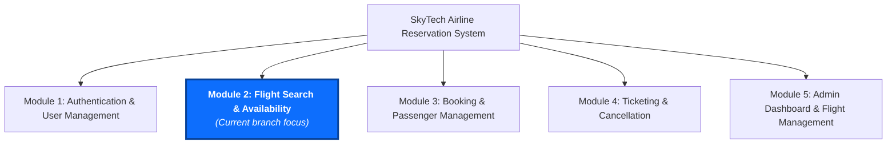

# SkyTech — Airline Reservation System

SkyTech is a Java-based web application designed to simplify flight search and support airline reservation workflows through a modular software architecture.

The application organizes flight discovery, travel details, passenger management, booking workflows, ticketing, and administrative functionality into distinct functional areas.

The current development focus is **Flight Search & Availability**.

> **Notice:** SkyTech is a demonstration software application. It does not operate commercial aircraft or issue live commercial airline tickets.

---

## Project Overview

Flight reservation systems require travelers to search available routes, compare cabin classes, inspect flight schedules, and review seat availability. SkyTech addresses these requirements through a modular Model-View-Controller (MVC) architecture built with Java Servlets, JavaServer Pages (JSP), JDBC persistence, and external flight data integration.

- **Architecture & Design:** Implements relational database normalization, server-side parameter validation, separation of concerns, and resilient external API consumption.
- **Current Branch Focus:** Implements the flight discovery and availability pipeline, including airport autocomplete, one-way, round-trip, and multi-city route configuration, flight results filtering and sorting, aircraft details, and cabin seat map selection.
- **Data Provider Architecture:** Supports live external flight data via ReefAPI when configured, alongside local MySQL catalog data when running offline.

---

## Module 2: Flight Search & Availability

This branch delivers the core flight discovery and availability workflow. Features in the codebase include:

### Verified Implementation

1. **Route & Date Selection:**
   - **Airport Search & Autocomplete:** Asynchronous query endpoint (`/api/airports`) supporting search by IATA airport code, city name, and airport title.
   - **Interactive Airport Swapping:** One-click origin and destination interchange with input synchronization.
   - **Timezone-Aware Date Selection:** Custom calendar controls anchored to Asia/Kolkata (`ZoneId.of("Asia/Kolkata")`), preventing selection of past travel dates.
   - **Multiple Trip Types:**
     - **One-Way:** Direct flight search with departure date validation.
     - **Round-Trip:** Coordinated outbound and return dates with automatic chronological enforcement (return date must be on or after departure date).
     - **Multi-City:** Dynamic segment builder supporting 2 to 5 consecutive flight legs with sequential date validation.

2. **Passenger & Cabin Class Configuration:**
   - **Passenger Allocation:** Independent counters for Adults (1–9), Children (0–8), and Infants (0–4), enforcing a maximum of 9 passengers total and ensuring infants do not exceed accompanying adults.
   - **Cabin Class Tiers:** Support for Economy, Premium Economy, Business, and First Class tiers, with client-side price multiplier calculations.

3. **Flight Results & Filtering:**
   - **Results Display:** Card-based flight display presenting carrier logos, flight numbers, aircraft model, departure and arrival timestamps, terminal designations, journey duration, stops, and fare pricing.
   - **Client-Side Filters:** Interactive filtering by stops (Non-stop, 1 Stop), operating airline, departure time window (Morning, Afternoon, Evening, Night), and maximum price slider.
   - **Results Sorting:** Sorting by price (low to high, high to low), duration (shortest first), and departure time (earliest, latest).

4. **Flight Details & Seat Map Selection:**
   - **Flight Details Modal & View (`/flight-details`):** Breakdown of baggage allowances, cancellation terms, aircraft model specifications, and fare components.
   - **Interactive Cabin Seat Map (`/seat-selection`):** Dynamic 2D seat map rendering rows (1–20) and columns (A–F) for Airbus A320neo and Boeing 737 configurations, visually distinguishing Window, Aisle, Middle, Extra Legroom, and Exit Row seats with applicable seat selection fees.

5. **Search Query Audit Logging:**
   - **Audit Trail:** Asynchronous logging of search queries into the `flight_searches` MySQL table capturing origin, destination, travel dates, passenger counts, cabin class, and provider source.

### Demonstration & Auxiliary Views

- **Flight Status Lookup (`/flight-status`):** Standalone status inquiry interface for flight tracking demonstration.
- **Manage Booking Stub (`/manage-booking`):** PNR lookup interface demonstrating future handoff to the booking module.
- **Travel Information View (`/travel-information`):** Informational page outlining baggage policies and travel guidelines.
- **Diagnostics Page (`/project`):** Diagnostic overview reporting active configuration properties, database connection status, and module architecture.

---

## Application Screenshots

The following user interface captures illustrate the Flight Search & Availability workflow in SkyTech:

### Flight Search Interface (Homepage)

The landing search interface provides trip configuration (One-Way, Round-Trip, Multi-City), origin/destination airport autocomplete, timezone-aware departure date selection, passenger count controls, and cabin class selection.


### Flight Search Results & Availability

The flight results interface presents matching flight itineraries, carrier logos, aircraft equipment, departure/arrival times, journey durations, stops, and fare pricing, accompanied by interactive filters and sorting options.


> **Note:** Screenshots are provided for user interface reference. Displayed flight times, carriers, routes, and prices reflect demonstration catalog and test data.

---

## Technology Stack

Verified from the Maven build configuration (`pom.xml`) and application source code:

| Layer | Technology | Version | Purpose |
| :--- | :--- | :--- | :--- |
| **Language** | Java | 11 (LTS) | Core server-side application logic |
| **Web Framework** | Java Servlets | 4.0.1 (Servlet API) | HTTP request handling, validation & routing |
| **View Templating** | JavaServer Pages (JSP) & JSTL | 2.3.3 / 1.2 | Server-side view rendering and presentation |
| **Database Driver** | MySQL Connector/J | 8.3.0 | Relational database connectivity via JDBC |
| **Database** | MySQL | 8.x | Relational storage for airports, schedules & seats |
| **JSON Processing** | Google Gson / Jackson | 2.10.1 / 2.17.2 | JSON parsing and serialization |
| **Configuration** | Dotenv-Java | 3.0.2 | Server-side `.env` environment variable loading |
| **Frontend Styling** | Vanilla CSS3 & Bootstrap | 5.3.3 | Responsive UI design system, grid, and layout |
| **Iconography** | Bootstrap Icons | 1.11.3 | Airline carrier icons and navigation icons |
| **Client Scripting** | Vanilla JavaScript | ES6+ | Calendar engine, dynamic DOM builders, filters |
| **Build Tool** | Apache Maven | 3.x | Dependency management, compilation, WAR packaging |
| **Runtime Container** | Apache Tomcat / Eclipse Jetty | 9.0 / 10.0.22 | Servlet container runtime environment |

---

## System Architecture

SkyTech follows a layered architecture that separates the
presentation interface, request handling, business logic,
flight data integration, and database persistence.

The following diagram illustrates the system architecture
for the Flight Search & Availability functionality.


---

## Flight Search Request Flow

When a user submits a flight search query, the request travels through validation, provider selection, and result rendering:


---

## External Flight Data Provider & Error Handling

SkyTech uses a dual-engine data provider structure. The source of flight results depends strictly on the application's startup configuration:

| Scenario | Operational Behavior | Data Source / Outcome |
| :--- | :--- | :--- |
| **API key configured & request succeeds** | `ReefApiFlightProvider` executes an HTTPS POST query to `api.reefapi.com`. | Returns live flight itineraries, published carrier flight numbers, and live market fares. |
| **API key is missing / empty** | `ReefApiFlightProvider` routes requests to `DatabaseFlightProvider`. | Returns demonstration domestic flight schedules stored in local MySQL tables. |
| **API returns HTTP 429 (Rate Limit)** | The API client raises an `ApiException`. Caught by `FlightSearchController`. | An alert is displayed to the user explaining that provider rate limits were reached. **The application does not silently fall back to local database data on runtime API errors.** |
| **API returns HTTP 500 or timeout** | The API client raises an `ApiException`. Caught by `FlightSearchController`. | A user-friendly error message is displayed indicating temporary external provider unavailability. |
| **MySQL database is unavailable** | Caught during DAO queries (`SQLException` / general `Exception`). | Search execution reports a database error message. Asynchronous search history logging fails soft without crashing the user response. |

---

## Five-Module Project Organization

The complete SkyTech platform is structured into five functional areas:



### Module Breakdown

| Module | Functional Area |
| :---: | :--- |
| **1** | **Authentication & User Management** |
| **2** | **Flight Search & Availability — current branch focus** |
| **3** | **Booking & Passenger Management** |
| **4** | **Ticketing & Cancellation** |
| **5** | **Admin Dashboard & Flight Management** |

---

## Project Directory Structure

```
airline-reservation-system/
├── database/
│   └── schema.sql                  # MySQL 8.x schema DDL and seed records
├── src/
│   ├── main/
│   │   ├── java/
│   │   │   └── com/skytech/
│   │   │       ├── api/            # External API client, exceptions & payload parsing
│   │   │       ├── controller/     # HttpServlet routing controllers & API endpoints
│   │   │       ├── dao/            # Data Access Objects (JDBC PreparedStatements)
│   │   │       ├── filter/         # Global character encoding & request filters
│   │   │       ├── integration/    # FlightProvider interface & provider implementations
│   │   │       ├── model/          # Domain POJOs (Flight, Airport, Airline, Schedule, Seat)
│   │   │       ├── service/        # Business logic, seat pricing & route validation
│   │   │       └── util/           # AppConfig, DBConnectionUtil & airline utilities
│   │   ├── resources/
│   │   │   ├── api.properties.example # External API configuration template
│   │   │   └── db.properties.example  # JDBC database configuration template
│   │   └── webapp/
│   │       ├── assets/
│   │       │   ├── css/            # Custom style sheets (flight-search.css, style.css)
│   │       │   └── js/             # Client JavaScript (skytech-calendar.js, autocomplete)
│   │       └── WEB-INF/
│   │           ├── views/
│   │           │   ├── common/     # Shared headers, footers & navigation components
│   │           │   ├── flight/     # Flight search, results, details & seat views
│   │           │   ├── error.jsp   # Global error display page
│   │           │   ├── index.jsp   # Homepage with flight search widget
│   │           │   └── project.jsp # System status & diagnostics view
│   │           └── web.xml         # Servlet mappings & deployment descriptor
│   └── test/
│       └── java/                   # JUnit unit and integration tests
├── .env.example                    # Environment variable configuration template
├── .gitignore                      # Git exclusion rules (.env, properties, target)
├── pom.xml                         # Maven project configuration & dependency definitions
├── mvnw / mvnw.cmd                 # Maven wrapper scripts (Unix & Windows)
└── Readme.md                       # Repository documentation
```

---

## Database Setup

SkyTech uses MySQL 8.x for relational persistence. The database schema script is maintained in [database/schema.sql](database/schema.sql).

### Key Tables

- `airports`: Airport codes (IATA 3-letter), airport names, cities, countries, and terminal identifiers.
- `airlines`: Airline codes (IATA/ICAO), carrier names, and icon class identifiers.
- `flights`: Master flight definitions with origin, destination, times, durations, and aircraft models.
- `flight_schedules`: Flight instances by date, including base, economy, business, and first-class pricing, total seats, and available seats.
- `aircraft`: Aircraft fleet definitions, model names, manufacturers, row counts, and seat layouts.
- `aircraft_seats`: Physical seat definitions (window, aisle, middle, extra legroom) and selection fees.
- `flight_seat_inventory`: Dynamic seat status (`AVAILABLE`, `OCCUPIED`, `BLOCKED`) per schedule.
- `flight_searches`: Audit log storing search criteria, passenger breakdowns, and provider metadata.

### Database Entity-Relationship (ER) Diagram


---

## Prerequisites

To compile, test, and run SkyTech, the following tools are required:

- **Java Development Kit (JDK):** Version 11 or higher.
- **Apache Maven:** Version 3.8.0 or higher (or use the included Maven Wrapper `./mvnw`).
- **MySQL Server:** Version 8.0 or higher.
- **Servlet Container:** Apache Tomcat 9.0.x (or Eclipse Jetty via the Maven plugin).

---

## Installation and Configuration

### 1. Clone the Repository

```bash
git clone https://github.com/nikhilranjanchoubey/airline-reservation-system.git
cd airline-reservation-system
```

### 2. Initialize the Database

Open your MySQL client and execute the initialization script:

```bash
mysql -u root -p < database/schema.sql
```

This creates the `skytech_db` database and seeds Indian domestic airports, airlines, aircraft layouts, and sample schedules.

### 3. Configure Application Properties

SkyTech resolves configuration through `AppConfig.java` using a three-tier hierarchy:
1. **System Environment Variables** (highest priority)
2. **Project Root `.env` file** (second priority)
3. **Classpath properties files** (fallback priority)

Create a `.env` file in the project root based on [.env.example](.env.example):

```properties
# External Flight Provider Configuration (Optional)
REEF_API_KEY=YOUR_REEF_API_KEY
REEF_API_URL=https://api.reefapi.com

# Database Configuration
DB_URL=jdbc:mysql://<db-host>:3306/skytech_db?useSSL=false&allowPublicKeyRetrieval=true&serverTimezone=Asia/Kolkata
DB_USERNAME=<db-username>
DB_PASSWORD=<db-password>
```

Alternatively, configure `src/main/resources/db.properties` based on [src/main/resources/db.properties.example](src/main/resources/db.properties.example).

> **Security Reminder:** Never commit `.env` or files containing active passwords to version control. The repository's [.gitignore](.gitignore) automatically excludes sensitive configuration files.

---

## Build and Deployment

### Option A: Running with Maven Jetty Plugin (Development)

Run the application directly using the Maven Jetty plugin configured in `pom.xml`:

```bash
mvn clean jetty:run
```

Or using the Maven Wrapper:

- **Windows:** `mvnw.cmd clean jetty:run`
- **Linux / macOS:** `./mvnw clean jetty:run`

### Option B: Packaging and Deploying to Apache Tomcat 9

1. Build the production WAR package:

```bash
mvn clean package
```

2. The build generates the deployable artifact at:
   `target/skytech.war`

3. Deploy `target/skytech.war` by copying it into your Apache Tomcat installation's `webapps/` directory:

- **Linux / macOS:** `cp target/skytech.war $CATALINA_HOME/webapps/`
- **Windows:** `copy target\skytech.war %CATALINA_HOME%\webapps\`

4. Start Apache Tomcat using `$CATALINA_HOME/bin/startup.sh` (or `startup.bat` on Windows).

---

## Validation, Security, and Error Handling

- **Server-Side Search Validation:**
  - Origin and destination codes cannot be identical.
  - Departure dates cannot be in the past (validated against `Asia/Kolkata` local time).
  - Round-trip return dates must fall on or after departure dates.
  - Passenger counts must be between 1 and 9; infants cannot exceed accompanying adults.
  - Multi-city itineraries require 2 to 5 consecutive segments with chronological date progression.
- **SQL Injection Prevention:** All database operations in the DAO layer use JDBC `PreparedStatement` with parameterized queries.
- **Credential Protection:** Secrets (`REEF_API_KEY`, database passwords) are loaded via environment variables or git-ignored configuration files and are never exposed in log outputs or client-facing views.
- **Character Encoding:** A global `CharacterEncodingFilter` (`web.xml`) enforces UTF-8 across all request and response cycles.
- **Error Handling:** Unhandled exceptions and API failures route to `error.jsp`, presenting user-friendly explanations without disclosing internal stack traces.

---

## Current Limitations

- **Booking Completion:** This branch (`feature/flight-search`) provides search, filter, and seat selection; booking finalization and PNR generation belong to Module 3.
- **Payment Processing:** Payment gateway integration is not implemented on this branch (scheduled for Module 4).
- **Seat Reservation Locking:** Seat selection displays layout and pricing, but temporary inventory holds require the upcoming booking service.
- **Live Provider Coverage:** External API searches depend on active ReefAPI credentials and network availability.
- **Local Catalog Scope:** Offline database records cover primary domestic routes; multi-city search using the offline catalog relies on routes present in [database/schema.sql](database/schema.sql).

---

## Future Improvements

- **Passenger Manifest Integration:** Connect the seat selection handoff directly into the Module 3 booking flow.
- **Distributed Caching:** Introduce caching for frequent route queries to reduce API latency and minimize external provider calls.
- **Seat Locking Timers:** Implement temporary reservation timers (e.g., 10-minute seat holds) during checkout.

---

## Team Collaboration

SkyTech uses a structured Git feature-branch workflow for collaborative development:

- **Branch Isolation:** Each functional area is developed on dedicated feature branches (e.g., `feature/flight-search`, `feature/authentication`, `feature/booking`, `feature/ticketing`, `feature/admin`).
- **Code Review:** Branch changes are integrated into the primary branch through Pull Requests following review and build verification.
- **Configuration Hygiene:** Environment files and compiled artifacts are strictly excluded from source control.

---

## Acknowledgements

- **Open-Source Software & Libraries:**
  - [Apache Tomcat](https://tomcat.apache.org/) & [Eclipse Jetty](https://eclipse.dev/jetty/)
  - [Bootstrap & Bootstrap Icons](https://getbootstrap.com/)
  - [MySQL Connector/J](https://dev.mysql.com/doc/connector-j/en/)
  - [Jackson](https://github.com/FasterXML/jackson) & [Gson](https://github.com/google/gson)
  - [dotenv-java](https://github.com/cdimascio/dotenv-java)
