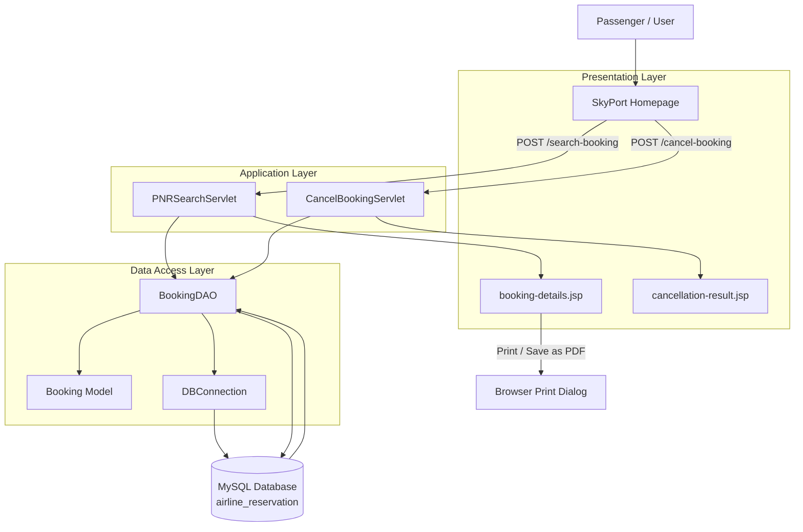
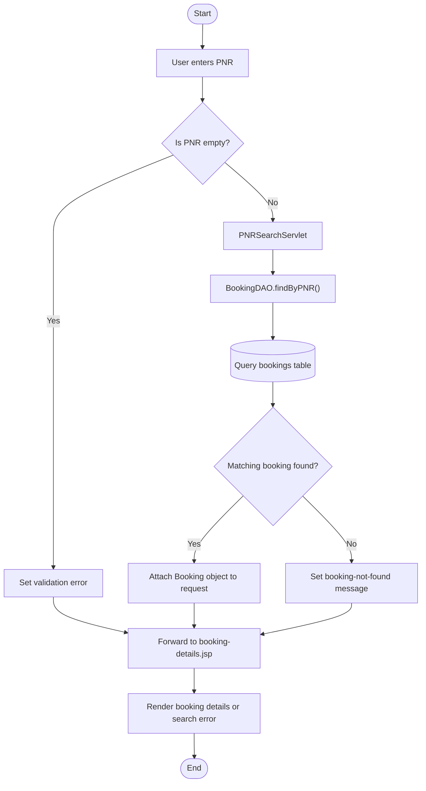
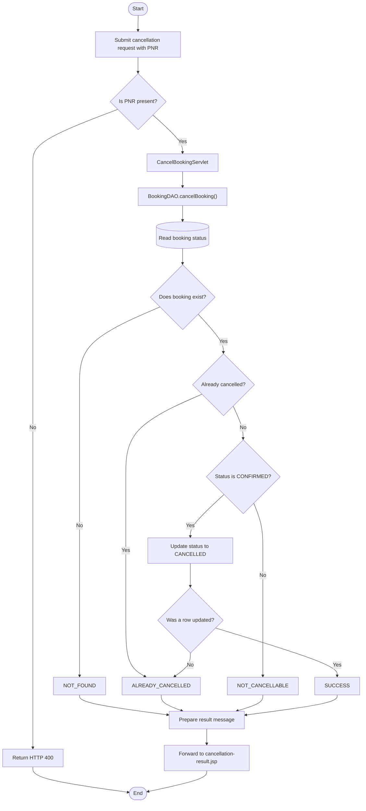
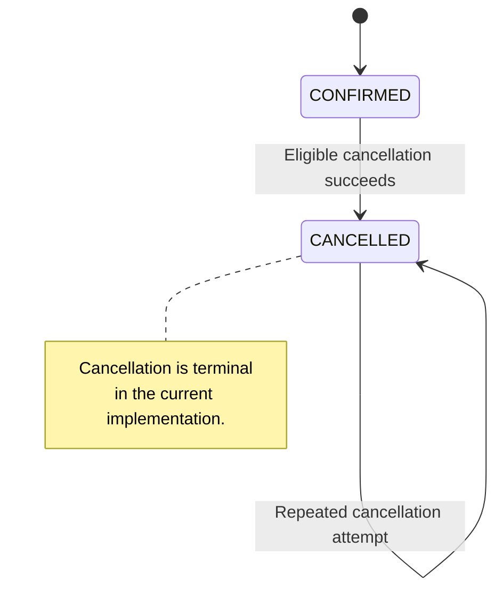
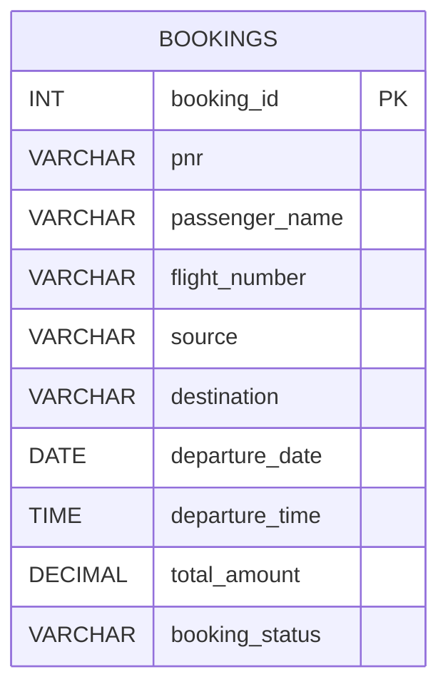

<div align="center">

# ✈️ SkyPort
### Airline Reservation System

**Ticketing & Cancellation Module**

*A Java-based web application for PNR-based booking retrieval, electronic ticket management, and booking cancellation.*

<br>


<br>

**Module 04 · Ticketing & Cancellation**

[Overview](#overview) ·
[Features](#key-features) ·
[Architecture](#system-architecture) ·
[Database](#database-design) ·
[Setup](#installation-and-setup) ·
[Testing](#testing-and-validation)

</div>

---

## Table of Contents

- [Overview](#overview)
- [Project Scope](#project-scope)
- [Key Features](#key-features)
- [Technology Stack](#technology-stack)
- [System Architecture](#system-architecture)
- [Application Workflows](#application-workflows)
- [Project Structure](#project-structure)
- [Database Design](#database-design)
- [Application Endpoints](#application-endpoints)
- [Installation and Setup](#installation-and-setup)
- [Testing and Validation](#testing-and-validation)
- [Security and Engineering Considerations](#security-and-engineering-considerations)
- [Future Enhancements](#future-enhancements)
- [Project Information](#project-information)

---

## Overview

**SkyPort Airline Reservation System** is a Java-based web application developed as part of an academic software development project. The system is designed around airline reservation workflows, with this module focusing on retrieving booking information, displaying electronic ticket details, and processing ticket cancellation requests.

The **Ticketing & Cancellation module (Module 04)** provides a dedicated interface through which users can retrieve an existing reservation using a Passenger Name Record (PNR), review flight and passenger details, check the current booking status, and view cancellation results.

The module uses Java Servlets for request processing, JSP for presentation, JDBC for database connectivity, and MySQL for persistent booking information.

### Module Objectives

- Provide reliable PNR-based booking retrieval.
- Present booking and flight information in a structured electronic-ticket interface.
- Display booking status clearly.
- Process eligible cancellation requests and update booking status.
- Communicate cancellation outcomes through a dedicated result page.
- Support browser-based ticket printing and PDF export.
- Maintain a consistent, responsive SkyPort user interface.

## Project Scope

This repository contribution focuses on **Module 04 — Ticketing & Cancellation** within the wider team project.

| Module | Responsibility |
|---|---|
| Module 01 | Authentication and User Management |
| Module 02 | Flight Search and Availability |
| Module 03 | Booking and Passenger Management |
| **Module 04** | **Ticketing and Cancellation — Current Module** |
| Module 05 | Admin Dashboard and Flight Management |

This module works with booking records stored in the shared database. Booking creation, authentication, flight search, and administrative flight management are responsibilities of other modules in the wider system.

---

## Key Features

### 1. PNR-Based Booking Retrieval

- Accepts a passenger's PNR as the booking reference.
- Validates empty input before querying the database.
- Retrieves matching booking information through the DAO layer.
- Displays an informative message when no matching record exists.

### 2. Electronic Ticket Display

The ticket interface presents:

- Passenger name
- PNR / booking reference
- Flight number
- Source and destination
- Departure date and time
- Total ticket fare
- Current booking status

### 3. Booking Status Management

The module displays booking states and handles cancellation requests according to the stored booking status.

| Booking condition | Expected behaviour |
|---|---|
| `CONFIRMED` | Booking details are displayed with confirmed status |
| `CANCELLED` | Cancellation status and relevant warning are displayed |
| Other status | Current status is displayed for verification |
| PNR not found | An informative booking-not-found message is displayed |

### 4. Ticket Cancellation

The cancellation workflow:

1. Receives a PNR through an HTTP POST request.
2. Validates the submitted PNR.
3. Checks the existing booking status.
4. Updates eligible confirmed bookings to `CANCELLED`.
5. Returns a result representing the outcome.
6. Displays the result on the cancellation result page.

Repeated cancellation attempts are handled separately from successful cancellation requests.

### 5. Print and PDF Export

The electronic-ticket page includes a browser-based print action.

- Print the ticket.
- Save the ticket as PDF using the browser's print dialog.
- Apply A4 portrait print styling.
- Hide navigation and interactive buttons in print mode.

PDF generation is performed through the browser's print functionality rather than a separate server-side PDF-generation library.

### 6. Responsive User Interface

The SkyPort interface uses a consistent design system featuring:

- Navy-blue navigation
- Blue and cyan accents
- Clear status indicators
- Structured booking information cards
- Responsive layouts for smaller screens
- Accessible keyboard focus indicators
- Inter and Manrope typography

---

## Technology Stack

| Layer | Technology | Purpose |
|---|---|---|
| Programming Language | Java 17 | Application logic |
| Presentation | JSP, HTML5, CSS3 | User interface and ticket rendering |
| Request Handling | Jakarta Servlets | HTTP request processing |
| Data Access | JDBC | Database communication |
| Data Layer | MySQL | Persistent booking records |
| JDBC Driver | MySQL Connector/J | MySQL connectivity |
| Application Server | Apache Tomcat 11 | Web application execution |
| Typography | Google Fonts | Inter and Manrope |
| IDE | Eclipse IDE for Enterprise Java and Web Developers | Development and debugging |
| Version Control | Git and GitHub | Source control and collaboration |

---

## System Architecture

The module follows a layered architecture that separates the presentation, request-handling, data-access, and database responsibilities.



### Architectural Responsibilities

| Component | Responsibility |
|---|---|
| JSP pages | Render booking details, search errors, and cancellation results |
| `PNRSearchServlet` | Validate PNR input and coordinate booking retrieval |
| `CancelBookingServlet` | Validate cancellation requests and interpret cancellation results |
| `BookingDAO` | Execute parameterized SQL queries and booking-status updates |
| `Booking` | Represent the booking data returned by the DAO |
| `DBConnection` | Establish JDBC connections to MySQL |
| MySQL | Persist booking details and status |

---

## Application Workflows

### 1. PNR Search Workflow



### 2. Ticket Cancellation Workflow



### 3. Booking Status Transition

The current cancellation logic supports the following transition:



The diagram describes the cancellation logic implemented in this module. Other booking-status transitions are not assumed.

---

## Project Structure

The following structure lists the relevant Java and web resources for Module 04.

```text
AirlineReservationSystem/
│
├── src/
│   └── main/
│       ├── java/
│       │   └── com/
│       │       └── skyport/
│       │           │
│       │           ├── dao/
│       │           │   └── BookingDAO.java
│       │           │
│       │           ├── model/
│       │           │   └── Booking.java
│       │           │
│       │           ├── servlet/
│       │           │   ├── PNRSearchServlet.java
│       │           │   └── CancelBookingServlet.java
│       │           │
│       │           └── util/
│       │               ├── DBConnection.java
│       │               └── DBConnectionTest.java
│       │
│       └── webapp/
│           ├── index.html
│           ├── booking-details.jsp
│           ├── cancellation-result.jsp
│           ├── bookingHistory.jsp
│           │
│           └── WEB-INF/
│               ├── lib/
│               └── web.xml
│
├── .gitignore
├── .classpath
├── .project
└── README.md
```

*Note: The structure reflects the module files identified during development. Additional files may exist in the complete project.*

### Core File Responsibilities

| File | Responsibility |
|---|---|
| `Booking.java` | Booking data model and getter/setter methods |
| `BookingDAO.java` | PNR lookup and booking cancellation operations |
| `PNRSearchServlet.java` | Handles booking-search POST requests |
| `CancelBookingServlet.java` | Handles cancellation POST requests |
| `DBConnection.java` | Creates a MySQL JDBC connection |
| `DBConnectionTest.java` | Utility for testing database connectivity |
| `booking-details.jsp` | Electronic-ticket display and booking-search feedback |
| `cancellation-result.jsp` | Cancellation outcome and navigation |
| `index.html` | Main SkyPort entry page |
| `bookingHistory.jsp` | Booking-history interface in the wider project, subject to integration |

---

## Database Design

### Database Configuration

| Property | Value |
|---|---|
| Database name | `airline_reservation` |
| Main table | `bookings` |
| Database engine | MySQL |
| Access technology | JDBC |
| Data-access component | `BookingDAO` |

### Booking Table

The DAO currently expects the following columns in the `bookings` table.

| Column | Purpose |
|---|---|
| `booking_id` | Unique booking record identifier |
| `pnr` | Passenger Name Record / booking reference |
| `passenger_name` | Passenger name |
| `flight_number` | Flight identifier |
| `source` | Departure city or airport |
| `destination` | Arrival city or airport |
| `departure_date` | Scheduled departure date |
| `departure_time` | Scheduled departure time |
| `total_amount` | Total ticket fare |
| `booking_status` | Current booking status |

### Entity Representation



The DAO uses the `bookings` table directly. Separate passenger, flight, user, and payment tables are not assumed by the current Module 04 DAO implementation.

### Illustrative Record

| booking_id | pnr | passenger_name | flight_number | source | destination | booking_status |
|---:|---|---|---|---|---|---|
| 1 | `SK8P2Q` | Sample Passenger | `SP101` | Jaipur | Delhi | `CONFIRMED` |

*This is illustrative test data, not a real reservation.*

### Cancellation Result Mapping

| Condition | DAO result | Expected outcome |
|---|---|---|
| PNR does not exist | `NOT_FOUND` | No booking is cancelled |
| Booking is already cancelled | `ALREADY_CANCELLED` | Existing status remains unchanged |
| Confirmed booking is cancelled successfully | `SUCCESS` | Status becomes `CANCELLED` |
| Booking has another status | `NOT_CANCELLABLE` | No cancellation update is performed |

**Database consistency:** The actual SQL schema in your local database is the source of truth. Ensure its column names and types match the DAO implementation.

---

## Application Endpoints

The servlet mappings are defined through `@WebServlet` annotations.

| Endpoint | HTTP Method | Component | Purpose |
|---|---|---|---|
| `/search-booking` | POST | `PNRSearchServlet` | Retrieve a booking by PNR |
| `/cancel-booking` | POST | `CancelBookingServlet` | Request booking cancellation |
| `/index.html` | GET | Static web resource | Open the SkyPort homepage |

### Request Processing

**PNR search**

```text
User
  → POST /search-booking
  → PNRSearchServlet
  → BookingDAO.findByPNR()
  → MySQL
  → booking-details.jsp
```

**Cancellation**

```text
User
  → POST /cancel-booking
  → CancelBookingServlet
  → BookingDAO.cancelBooking()
  → MySQL
  → cancellation-result.jsp
```

The JSP pages use `request.getContextPath()` when generating application-relative navigation links. The actual base URL depends on the configured Tomcat context path.

---

## Installation and Setup

### Prerequisites

Install and configure the following:

- Java Development Kit (JDK) 17
- Eclipse IDE for Enterprise Java and Web Developers
- Apache Tomcat 11
- MySQL Server
- MySQL Connector/J
- Git

### Step 1 — Clone the Repository

```bash
git clone https://github.com/nikhilranjanchoubey/airline-reservation-system.git
cd airline-reservation-system
```

If you are working on the ticketing branch:

```bash
git checkout feature/ticketing
```

Confirm the repository URL and branch name against your team's GitHub repository before running these commands.

### Step 2 — Import into Eclipse

1. Open Eclipse.
2. Select **File → Import**.
3. Choose the Git repository or existing-project import option.
4. Select the cloned project directory.
5. Confirm the project is recognized as `AirlineReservationSystem`.
6. Verify the Java compiler and project build path use JDK 17.
7. Configure Tomcat 11 under the project's targeted runtimes.

### Step 3 — Create the Database

Run the following SQL in MySQL Workbench if the database does not already exist:

```sql
CREATE DATABASE IF NOT EXISTS airline_reservation;
USE airline_reservation;
```

If the `bookings` table already exists, inspect it before creating or modifying anything.

For a fresh local test database, the following table definition matches the column names used by the DAO:

```sql
CREATE TABLE IF NOT EXISTS bookings (
    booking_id INT PRIMARY KEY AUTO_INCREMENT,
    pnr VARCHAR(30) NOT NULL UNIQUE,
    passenger_name VARCHAR(120) NOT NULL,
    flight_number VARCHAR(20) NOT NULL,
    source VARCHAR(100) NOT NULL,
    destination VARCHAR(100) NOT NULL,
    departure_date DATE,
    departure_time TIME,
    total_amount DECIMAL(10, 2) NOT NULL DEFAULT 0.00,
    booking_status VARCHAR(20) NOT NULL DEFAULT 'CONFIRMED'
);
```

For testing only, insert a sample booking if that PNR does not already exist:

```sql
INSERT INTO bookings (
    pnr,
    passenger_name,
    flight_number,
    source,
    destination,
    departure_date,
    departure_time,
    total_amount,
    booking_status
)
VALUES (
    'SK8P2Q',
    'Sample Passenger',
    'SP101',
    'Jaipur',
    'Delhi',
    '2027-01-15',
    '10:30:00',
    4500.00,
    'CONFIRMED'
);
```

This creates a sample record for local testing; it does not create a real airline reservation.

### Step 4 — Configure Database Connectivity

The current connection URL is:

```text
jdbc:mysql://localhost:3306/airline_reservation
```

Configure the database username and password in `DBConnection.java` for local development.

**Security requirement:** Never commit a real database password or other credentials to a public repository. Prefer environment variables or an external configuration file excluded from version control. Rotate any credential that has already been exposed publicly.

Confirm that MySQL Connector/J is available to the application at runtime.

### Step 5 — Run the Application

1. Start MySQL Server.
2. Start Eclipse.
3. Right-click `AirlineReservationSystem`.
4. Select **Run As → Run on Server**.
5. Choose the configured Tomcat 11 server.
6. Finish the wizard and wait for deployment.
7. Open the context path shown in Eclipse.

A common local URL is:

```text
http://localhost:8080/AirlineReservationSystem/
```

The exact URL may differ if the application context path or server port has been changed.

---

## Testing and Validation

Use the following test cases to validate the module after deployment.

| ID | Test case | Expected result |
|---|---|---|
| TC-01 | Submit an empty PNR | Validation error is displayed |
| TC-02 | Search for a valid PNR | Matching booking details are displayed |
| TC-03 | Search for an unknown PNR | Not-found message is displayed |
| TC-04 | Open a confirmed booking | Confirmed status is shown |
| TC-05 | Cancel a confirmed booking | Success result is displayed |
| TC-06 | Cancel the same booking again | Already-cancelled result is displayed |
| TC-07 | Cancel an unknown PNR | Not-found result is displayed |
| TC-08 | Cancel a booking with a different status | Not-cancellable result is displayed |
| TC-09 | Print an electronic ticket | Browser print dialog opens |
| TC-10 | Save the ticket as PDF | Browser can save the ticket as a PDF |
| TC-11 | Retrieve a booking after cancellation | Cancelled status is displayed |

These are validation scenarios. Mark a test as passed only after verifying it against the running application.

---

## Security and Engineering Considerations

The current module demonstrates several useful application-development practices:

- **Parameterized SQL:** PNR values are supplied through `PreparedStatement` parameters.
- **Input validation:** Empty PNR values are rejected.
- **HTML output escaping:** User-controlled or database-controlled values should be escaped before being rendered in HTML.
- **POST for cancellation:** State-changing cancellation requests use POST rather than a simple navigation link.
- **Status checks:** The DAO prevents cancellation when the booking is already cancelled or is not in the confirmed state.
- **Credential protection:** Database credentials should be externalized and excluded from source control.

### Recommended Hardening

Before any production-style deployment, consider adding:

- Authentication and authorization for booking access and cancellation.
- CSRF protection for state-changing requests.
- Transaction and concurrency handling for simultaneous cancellation attempts.
- Centralized logging and user-friendly exception handling.
- Environment-based database configuration.
- Automated tests for DAO and servlet behaviour.
- Validation of departure and fare data.
- A proper payment and refund workflow if required by the wider system.

The current cancellation implementation updates booking status; it does not process financial refunds.

---

## Future Enhancements

Potential extensions for the wider project include:

- Passenger authentication and ownership checks for PNR lookups.
- A searchable booking-history page integrated with the backend.
- Cancellation confirmation before the final status update.
- Transaction-safe cancellation processing.
- Refund eligibility and refund-status tracking.
- Email confirmation for ticket booking and cancellation.
- Automated unit and integration testing.
- Server-side PDF generation if downloadable ticket files are required.
- Centralized application logging and deployment configuration.

These are potential enhancements, not claims about existing functionality.

---

## Project Information

| Field | Details |
|---|---|
| Project | SkyPort Airline Reservation System |
| Module | Module 04 — Ticketing & Cancellation |
| Application Type | Java Web Application |
| Programming Language | Java 17 |
| Web Technologies | JSP, Jakarta Servlets, HTML, CSS |
| Database | MySQL |
| Server | Apache Tomcat 11 |
| Development Environment | Eclipse IDE |
| Version Control | Git and GitHub |

### Module Contribution

**Focus area:** Ticketing and Cancellation

The module covers PNR-based booking retrieval, electronic-ticket presentation, booking-status display, cancellation processing, cancellation result messaging, and browser-based printing.

---

<div align="center">

### SKYPORT ✈

**Your journey, made simple.**

*Developed as part of an academic software development project.*

</div>
