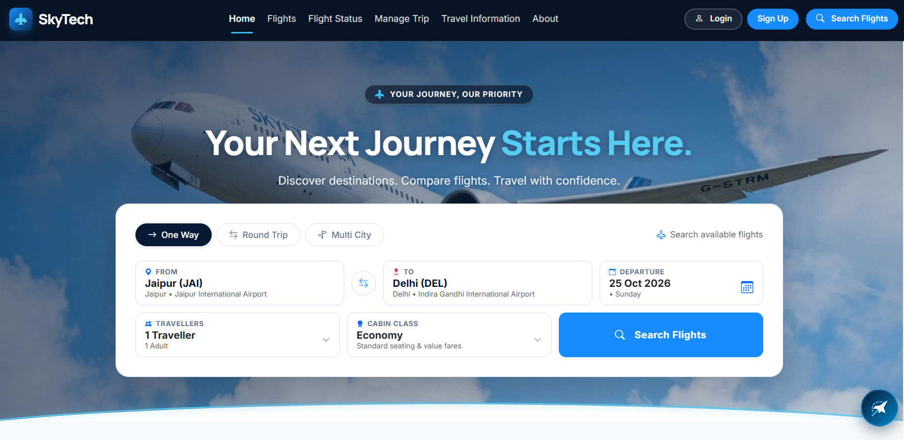
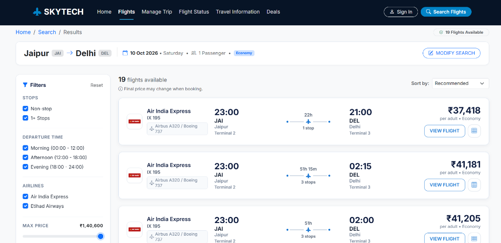
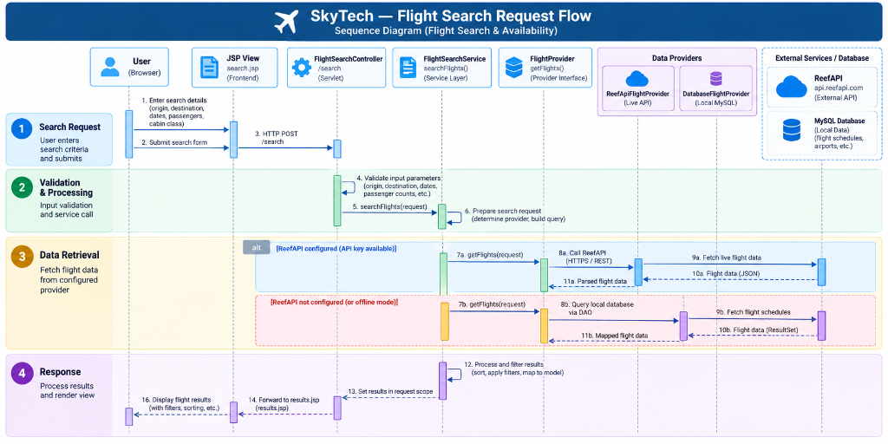
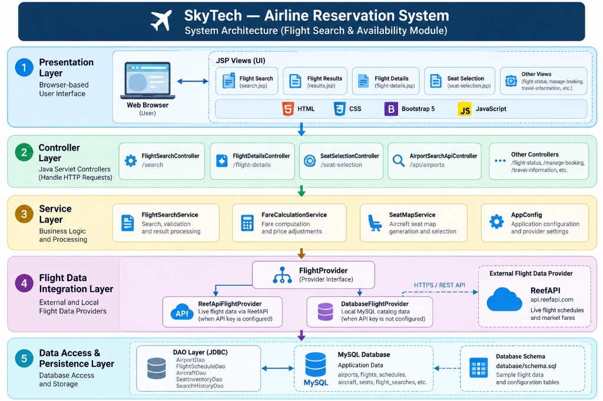
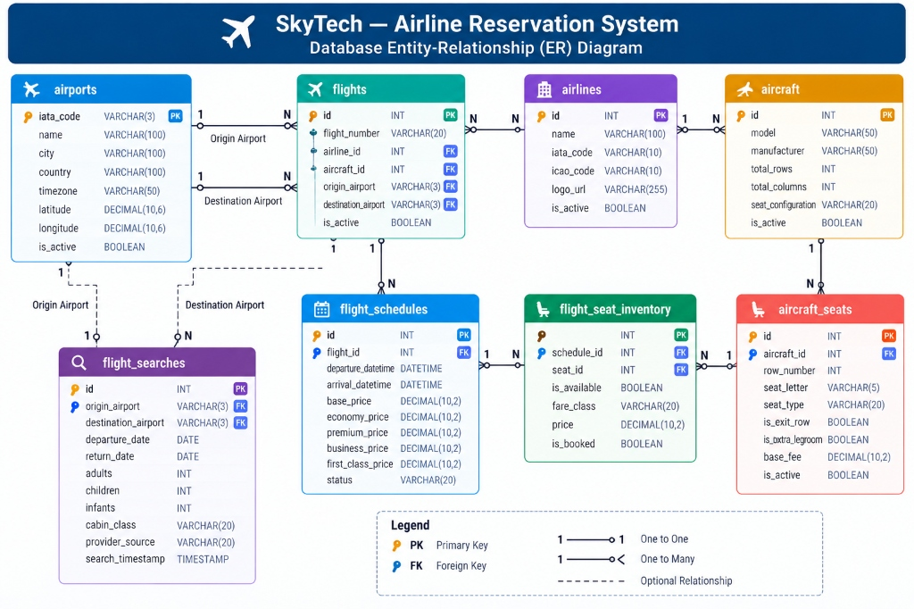

# ✈️ SkyTech — Airline Reservation System

[](https://www.oracle.com/java/)
[-E03C11?logo=eclipseide&logoColor=white)](https://jakarta.ee/)
[](https://www.mysql.com/)
[](https://tomcat.apache.org/)
[](https://www.docker.com/)
[](https://skytech-0l59.onrender.com/)
[](https://getbootstrap.com/)
[](https://github.com/LibrePDF/OpenPDF)
[](https://razorpay.com/)
[](#academic-attribution--license)

---

> ### 🚀 Live Demo: [https://skytech-0l59.onrender.com/](https://skytech-0l59.onrender.com/)
> **SkyTech is deployed live on Render.** Explore real-time flight searches, airport autocomplete, dynamic seat selection on Airbus A320neo / Boeing 737-800 fuselage grids, checkout with Razorpay, and instant vector PDF boarding pass generation.

| Resource | View Online | View Word Document |
| :--- | :--- | :--- |
| 📘 **Project Report** | <a href="docs/SkyTech_Airlines_Project_Report.pdf" target="_blank" rel="noopener noreferrer"><strong>View PDF</strong></a> | [**View DOCX**](docs/SkyTech_Airlines_Project_Report.docx) |
| 📄 **Software Requirements Specification (SRS)** | <a href="docs/SkyTech_Airlines_SRS.pdf" target="_blank" rel="noopener noreferrer"><strong>View PDF</strong></a> | [**View DOCX**](docs/SkyTech_Airlines_SRS.docx) |

---

## 📑 Table of Contents

- [Project Overview](#project-overview)
- [Key Features](#key-features)
- [Technology Stack](#technology-stack)
- [Project Documentation](#project-documentation)
- [Visual Preview & Screenshots](#visual-preview--screenshots)
- [System Architecture](#system-architecture)
- [Database Design & Relational Schema](#database-design--relational-schema)
- [Project Team Members & Contributions](#project-team-members--contributions)
- [10-Week Comprehensive Project Log](#10-week-comprehensive-project-log)
- [Application URL Route Map](#application-url-route-map)
- [Local Installation & Setup Guide](#local-installation--setup-guide)
- [Database & Environment Configuration](#database--environment-configuration)
- [Automated Testing Instructions](#automated-testing-instructions)
- [Production Deployment Information](#production-deployment-information)
- [Security Architecture & Best Practices](#security-architecture--best-practices)
- [Future Enhancements](#future-enhancements)
- [Academic Attribution & Acknowledgements](#academic-attribution--acknowledgements)

---

## <a id="project-overview"></a>🌟 Project Overview

**SkyTech** is an enterprise-grade, aviation-themed **Airline Reservation and Passenger Management System** developed as part of the 5th-semester **Java Project-Based Learning (PBL)** curriculum in the Department of Computer Science and Engineering.

Designed from the ground up to mirror the real-world operational workflows of premier commercial airlines (e.g., IndiGo, Air India, Vistara), SkyTech provides:
- **For Passengers:** A frictionless booking experience featuring real-time airport search autocomplete, dynamic multi-tier flight filtering, an interactive aircraft seat selection map, secure digital payment processing via Razorpay, and instant vector-quality electronic boarding pass generation with Code128 barcodes.
- **For Airline Administrators & Operations Staff:** An executive operations dashboard aggregating real-time KPIs, fleet aircraft configurations, route and schedule dispatchers, passenger manifest registries, revenue reporting, and tamper-evident audit logging.

Built using **Java 21 LTS** and the **Jakarta EE 10 / Servlet 6.0** specification without heavy ORM bloat, SkyTech leverages pure, optimized JDBC with connection-level transaction boundaries, achieving sub-millisecond query execution, rock-solid thread safety, and strict MVC architectural separation.

---

## <a id="key-features"></a>✨ Key Features

### 🛫 Passenger Portal & Booking Experience
- **Smart Flight Search Engine:** Supports One-Way, Round-Trip, and Multi-City flight searches across major domestic and international hubs.
- **Instant Airport Autocomplete (`/api/airports`):** Fast indexed prefix search matching IATA codes (e.g., DEL, BOM, BLR, JAI), city names, and airport titles.
- **Dynamic Multi-Criteria Filtering & Sorting:** Real-time client and server-side filtering by airline carrier, cabin class (Economy, Premium Economy, Business), number of stops (Non-stop vs. Connecting), and departure time windows, with dynamic sorting by lowest price, shortest duration, or earliest departure.
- **Interactive Aircraft Cabin Seat Map:** Visual fuselage layout rendering physical seat arrangements for Airbus A320neo and Boeing 737-800 aircraft with category tagging (`WINDOW`, `AISLE`, `MIDDLE`, `EXTRA_LEGROOM`) and live seat fare calculation.
- **Dual-Data Schedule Architecture:** Seamless external schedule querying (ReefAPI integration) paired with a resilient, zero-downtime offline fallback to local MySQL flight inventory.
- **Passenger Manifest Capture:** Captures structured traveler details (adults, children, infants) with input sanitization and form validation.
- **Secure Razorpay Payment Gateway:** Integrated order initialization, checkout modal rendering in INR (paise precision), and HMAC-SHA256 cryptographic payment signature verification.
- **Vector PDF E-Tickets & Boarding Passes:** High-resolution digital ticket generation using **OpenPDF 2.0.3** featuring custom aviation typography, itinerary route cards, passenger seat tables, GST fare breakdowns, and native Code128 vector barcodes.
- **"My Trips" Passenger Dashboard:** Self-service reservation lookup, live booking status tracking (`PENDING_PAYMENT`, `CONFIRMED`, `CANCELLED`), and secure PDF ticket retrieval.

### 🛡️ Administrative & Fleet Management
- **Executive Operations Dashboard (`/admin/dashboard`):** Real-time aggregation of 8 primary KPIs: Total Bookings, Active Flights, Fleet Seat Capacity, Verified Revenue (INR), Active Passengers, Pending Bookings, Cancellations, and Seat Utilization Rate.
- **Fleet & Aircraft Configuration (`/admin/aircraft`):** Fleet aircraft registry (Airbus A320neo, Boeing 737-800), cabin row structures, and physical seat capacity management.
- **Flight & Route Scheduling (`/admin/flights`):** Comprehensive CRUD operations for airport registries, flight schedules, departure/arrival timings, and base fare tiers.
- **Passenger Registry & Access Control (`/admin/passengers`):** Real-time passenger directory with administrative account status toggling (`ACTIVE` vs. `SUSPENDED`) and safeguard checks against admin self-suspension.
- **Financial & Payment Audit (`/admin/payments`):** Real-time payment ledger linking Razorpay transaction IDs, order IDs, payment status, and timestamps.
- **Security Audit Logging (`/admin/audit`):** Granular administrative action audit trail recording admin ID, action category, target entity, client IP address, and timestamp.

---

## <a id="technology-stack"></a>💻 Technology Stack

| Layer | Technologies & Libraries | Purpose & Details |
| :--- | :--- | :--- |
| **Backend Core** | **Java 21 LTS** | Primary runtime utilizing modern switch expressions, records, and virtual threads |
| **Web Tier** | **Jakarta EE 10 (Servlet 6.0, JSP 3.1, JSTL 3.0)** | High-performance request dispatching, filter pipelines, and dynamic server-side rendering |
| **Servlet Container** | **Apache Tomcat 10.1+** | Enterprise Servlet 6.0 / Jakarta EE runtime container |
| **Database & Persistence**| **MySQL 8.3+ / MariaDB** (Production) | Relational database schema with 3NF normalization, foreign keys, and indexes |
| **Database Connectivity**| **JDBC (MySQL Connector/J 8.3.0)** | Pure, performant JDBC with parameterized `PreparedStatement` to eliminate ORM overhead |
| **Frontend & UI** | **Bootstrap 5.3, Vanilla CSS3, JavaScript (ES6+)** | Responsive aviation UI featuring glassmorphism cards, custom badges, and interactive modals |
| **PDF Generation** | **OpenPDF 2.0.3** | Clean vector boarding pass e-tickets with integrated `Barcode128` vector barcodes |
| **Payment Gateway** | **Razorpay Orders API & Checkout JS** | Secure online card/UPI/net-banking payment processing with HMAC-SHA256 signature verification |
| **Authentication & Security**| **PBKDF / Salted SHA-256 + Google Identity (GIS)** | 16-byte cryptographically secure salt hashing, session fixation protection, and Google OAuth 2.0 |
| **Build & Tooling** | **Apache Maven 3.9+ (Maven Wrapper included)** | Standardized dependency management, multi-stage compilation, and automated test execution |
| **Testing Framework** | **JUnit 5 (Jupiter 5.10.2) + Mockito 5.11.0** | Comprehensive unit, mock, and integration test coverage across services, DAOs, and filters |
| **Containerization** | **Docker (Multi-Stage Build)** | Build stage (Maven + Temurin 21) and runtime stage (Tomcat 10.1 + MariaDB) |
| **Cloud Hosting** | **Render (Web Service)** | Production continuous deployment running containerized Docker workloads |

---

## <a id="project-documentation"></a>📚 Project Documentation

The repository includes complete, formal academic engineering documentation located in the [`docs/`](docs/) directory. Both documents are tracked in Git and can be accessed or downloaded directly on GitHub:

- 📘 **Project Report:**
  - 📄 **PDF (View Online):** <a href="docs/SkyTech_Airlines_Project_Report.pdf" target="_blank" rel="noopener noreferrer"><strong>SkyTech Airlines Project Report (PDF)</strong></a>
  - 📝 **Word Document:** [**Download DOCX**](docs/SkyTech_Airlines_Project_Report.docx)  
  *Detailed academic report covering domain background, system objectives, architectural diagrams, database normalization, module implementation summaries, security mechanisms, test matrices, and evaluation results.*

- 📄 **Software Requirements Specification (SRS):**
  - 📄 **PDF (View Online):** <a href="docs/SkyTech_Airlines_SRS.pdf" target="_blank" rel="noopener noreferrer"><strong>SkyTech Airlines SRS (PDF)</strong></a>
  - 📝 **Word Document:** [**Download DOCX**](docs/SkyTech_Airlines_SRS.docx)  
  *Comprehensive IEEE-standard SRS document detailing functional and non-functional requirements, use cases, actor interactions, security constraints, performance benchmarks, and interface specifications for all five system modules.*

---

## <a id="visual-preview--screenshots"></a>📸 Visual Preview & Screenshots

### 1. Flight Search & Discovery Homepage
Modern glassmorphism interface featuring dynamic origin/destination selection with IATA autocomplete, trip type switching (One-Way / Round-Trip / Multi-City), departure calendar, passenger count, and cabin class selectors.



---

### 2. Live Flight Search Results & Dynamic Availability
Comprehensive flight results grid displaying the updated navigation bar, real-time carrier itineraries (IndiGo, Air India, Vistara), flight cards with fare pricing in INR, departure/arrival timelines, non-stop/connection badges, and interactive faceted filters.



---

### 3. Interactive Flight Search & Reservation Sequence Flow
End-to-end user interaction flow from search initiation, autocomplete querying, schedule resolution, seat assignment, Razorpay payment processing, and PDF ticket dispatch.



---

## <a id="system-architecture"></a>🏛️ System Architecture

SkyTech implements a strict, decoupling-oriented **Model-View-Controller (MVC)** layered architecture deployed on Apache Tomcat 10.1 (Jakarta EE 10 / Servlet 6.0 specification).



### Architectural Layering

```
+-----------------------------------------------------------------------------------------+
|                                      CLIENT TIER                                        |
|  Bootstrap 5.3 UI • Glassmorphism Aesthetic • Airport Autocomplete • Seat Selection    |
|  Interactive Flight Filters • Razorpay Modal • Google Identity Services (GIS)           |
+-----------------------------------------------------------------------------------------+
                                             │ HTTP / HTTPS
                                             ▼
+-----------------------------------------------------------------------------------------+
|                              JAKARTA EE 10 SERVLET ENGINE                               |
|                                                                                         |
|  [Security & Encoding Filters]                                                          |
|    - CharacterEncodingFilter (UTF-8 Enforced across all request/response streams)       |
|    - AuthenticationFilter (/profile, /my-bookings, /user/*)                             |
|    - AdminAuthorizationFilter (/admin/*, Role-Based Clearance)                          |
|                                                                                         |
|  [Module 1: Authentication Controllers]                                                 |
|    - LoginServlet (/login)               - LogoutServlet (/logout)                      |
|    - RegisterServlet (/register)         - ProfileServlet (/profile)                    |
|    - GoogleAuthServlet (/auth/google)    - AvatarServlet (/avatar)                      |
|                                                                                         |
|  [Module 2: Flight Search Controllers]                                                  |
|    - HomeController (/)                  - FlightSearchController (/search-flights)     |
|    - FlightResultsController (/flight-results) - FlightDetailsController (/flight-details)|
|    - SeatSelectionController (/seat-selection) - AirportSearchApiController (/api/airports)|
|                                                                                         |
|  [Modules 3 & 4: Booking, Payment & Ticketing Controllers]                              |
|    - CheckoutController (/checkout)      - BookingConfirmationController (/confirmation)|
|    - MyBookingsController (/my-bookings) - TicketController (/ticket/download, /ticket/view)|
|                                                                                         |
|  [Module 5: Admin Management Controllers]                                               |
|    - AdminDashboardServlet (/admin, /admin/dashboard)                                   |
|    - AdminAircraftServlet (/admin/aircraft) - AdminFlightServlet (/admin/flights)       |
|    - AdminBookingServlet (/admin/bookings) - AdminPassengerServlet (/admin/passengers)  |
|    - AdminPaymentServlet (/admin/payments) - AdminAuditServlet (/admin/audit)           |
+-----------------------------------------------------------------------------------------+
                         │                                         │
                         ▼                                         ▼
+--------------------------------------------+    +---------------------------------------+
|             SERVICE & DAO TIER             |    |         EXTERNAL INTEGRATIONS         |
|  - UserService, UserDao                    |    |  - ReefAPI Client (Live Schedules)    |
|  - FlightSearchService, SeatDao            |    |  - Razorpay Gateway (Payments)        |
|  - BookingService, BookingDao              |    |  - Google Identity OAuth2 Verifier    |
|  - PaymentService, PaymentDao              |    |  - OpenPDF Engine (Vector Barcodes)   |
|  - TicketService (Aviation Boarding Pass)  |    +---------------------------------------+
|  - AdminDashboardDao, AircraftDao          |
|  - AdminAuditDao, AppConfig                |
+--------------------------------------------+
                         │ JDBC (MySQL Connector/J 8.3)
                         ▼
+-----------------------------------------------------------------------------------------+
|                                    PERSISTENT STORAGE                                   |
|                               MySQL 8.3 Database (skytech_db)                           |
|  users, roles, airports, airlines, flights, flight_schedules, aircraft, aircraft_seats, |
|  flight_seat_inventory, bookings, passengers, payments, tickets, admin_audit_logs       |
+-----------------------------------------------------------------------------------------+
```

---

## <a id="database-design--relational-schema"></a>🗄️ Database Design & Relational Schema

The relational database is normalized to **Third Normal Form (3NF)** to eliminate redundancy while preserving referential integrity through foreign keys, cascade constraints, and unique indices.



### Core Relational Schema Reference

1. **`users`**: Passenger and administrative accounts (`id`, `name`, `email`, `password_hash`, `salt`, `role`, `status`, `phone`, `profile_photo`, `google_id`, `created_at`).
2. **`airports`**: Master IATA records (`id`, `iata_code`, `airport_name`, `city`, `country`, `active`). Indexed on `iata_code`, `city`, and `airport_name` for rapid prefix autocomplete.
3. **`airlines`**: Carrier profiles (`id`, `carrier_code`, `airline_name`, `logo_path`, `active`). Seeded with major carriers: IndiGo (6E), Air India (AI), Vistara (UK), SpiceJet (SG), and Akasa Air (QP).
4. **`flights`**: Master route catalog (`id`, `flight_number`, `airline_id`, `origin_airport_id`, `destination_airport_id`, `departure_time`, `arrival_time`, `duration_minutes`, `stops`).
5. **`flight_schedules`**: Date-specific flight operations (`id`, `flight_id`, `flight_date`, `economy_price`, `premium_price`, `business_price`, `available_seats`, `status`).
6. **`aircraft` & `aircraft_seats`**: Fleet configurations (Airbus A320neo, Boeing 737-800) and physical seat layouts (`row_number`, `seat_letter`, `cabin_class`, `is_extra_legroom`).
7. **`flight_seat_inventory`**: Per-flight dynamic seat reservations (`schedule_id`, `seat_id`, `booking_id`, `status: AVAILABLE / BLOCKED / OCCUPIED`).
8. **`bookings`**: Master reservations (`id`, `booking_reference`, `pnr`, `user_id`, `schedule_id`, `total_amount`, `contact_email`, `contact_phone`, `booking_status`, `booking_date`).
9. **`passengers`**: Individual traveler manifest items (`id`, `booking_id`, `first_name`, `last_name`, `passenger_type`, `seat_id`, `ticket_number`).
10. **`payments`**: Payment gateway transactions (`id`, `booking_id`, `razorpay_order_id`, `razorpay_payment_id`, `amount`, `currency`, `payment_status`, `payment_method`, `created_at`).
11. **`tickets`**: Boarding pass records (`id`, `booking_id`, `passenger_id`, `e_ticket_number`, `issue_date`, `barcode_data`).
12. **`admin_audit_logs`**: System administration audit trail (`id`, `admin_user_id`, `action_type`, `target_entity`, `ip_address`, `details`, `timestamp`).

The complete, unified DDL schema is maintained in [database/schema.sql](database/schema.sql).

---

## <a id="project-team-members--contributions"></a>👥 Project Team Members & Contributions

The engineering workload was structured across five specialized, high-impact modules. Each team member owned end-to-end design, implementation, and testing within their assigned module:

| # | Team Member | Enrollment No. | Institutional Email | Module Responsibility & Scope | Assigned Branch |
| :-: | :--- | :--- | :--- | :--- | :--- |
| **1** | **Mohammed Sahil** | `24E1ARCSM30P095` | [mohammedsahil9549@gmail.com](mailto:mohammedsahil9549@gmail.com) | **Module 1: Authentication & User Management**<br>User registration, login, logout, password hashing (salted SHA-256), Google Sign-In (GIS OAuth), session lifecycle, avatar uploads, and role-based route security (`AuthenticationFilter`). | `feature/authentication`<br>*(also mapped to `feature/mohammedsahil-auth`)* |
| **2** | **Mukesh Sah** | `24E1ARCSM30P097` | [mukeshsah6395@gmail.com](mailto:mukeshsah6395@gmail.com) | **Module 3: Booking & Passenger Management**<br>Booking lifecycle (`PENDING_PAYMENT` to `CONFIRMED`), unique PNR generation, passenger details capture, dynamic seat allocation, passenger booking history ("My Trips"), and reservation status retrieval. | `feature/booking`<br>*(also mapped to `feature/mukeshsah-booking`)* |
| **3** | **Muskan Raj** | `24E1ARCSF40P098` | [muskanraj172024@gmail.com](mailto:muskanraj172024@gmail.com) | **Module 4: Payment & Ticketing**<br>Razorpay payment gateway integration, order creation, signature verification, payment transaction auditing, and high-quality vector PDF E-Ticket generation using OpenPDF with Code128 barcodes. | `feature/ticketing`<br>*(also mapped to `feature/muskanraj-ticketing`)* |
| **4** | **Nikhil Ranjan Choubey** | `24E1ARCSM40P103` | [ranjannikhil476@gmail.com](mailto:ranjannikhil476@gmail.com) | **Module 2: Flight Search & Availability**<br>Airport search and autocomplete API (`/api/airports`), one-way/round-trip/multi-city search engine, flight filtering (airlines, stops, cabin class), sorting, live ReefAPI integration with offline catalog fallback, and aircraft seat map selection. | `feature/flight-search`<br>*(also mapped to `feature/nikhilranjanchoubey-flightsearch`)* |
| **5** | **Prashant Chaudhary** | `24E1ARCSM10P115` | [chaudharyprashant590@gmail.com](mailto:chaudharyprashant590@gmail.com) | **Module 5: Admin Dashboard & System Management**<br>Executive operations dashboard with 8 KPI cards, fleet aircraft and seat capacity management (`/admin/aircraft`), flight schedules CRUD, airport/airline registries, cancellations, revenue analytics, and audit logging. | `feature/admin`<br>*(also mapped to `feature/prashantchaudhary-admin`)* |

### Academic Mentorship
- **Faculty Mentor:** **Er. Ram Babu Buri**  
- **Department:** Department of Computer Science & Engineering (CSE)  
- **Academic Context:** 5th Semester — Java Project-Based Learning (PBL)  
- **Project Duration:** 6 July 2026 – 6 October 2026 (10 Weeks)  
- **Integration Workflow:** Feature branches integrated into `integration/skytech` and deployed to `main`.

---

## <a id="10-week-comprehensive-project-log"></a>📅 10-Week Comprehensive Project Log

### WEEK 1: Project Introduction and Requirements Analysis
- **Objectives:** Establish the core project vision, analyze domain requirements for airline flight reservations, define technology stack boundaries (Java 21, Jakarta EE 10, Tomcat 10.1, MySQL), and formulate team member roles.
- **Activities:** Conducted collaborative domain analysis on commercial airline booking platforms (IndiGo, Air India, Emirates). Evaluated booking workflows, ticket distribution rules, dynamic seat matrices, and administrative operational needs.
- **Technical Implementation:** Formulated the high-level system boundary document. Selected Jakarta Servlet 6.0, JSP 3.1, Maven multi-module dependency structure, and MySQL relational storage. Established the Git repository workflow with five feature branches and a shared integration branch.
- **Responsible Team Members:** All team members (Mohammed Sahil, Mukesh Sah, Muskan Raj, Nikhil Ranjan Choubey, Prashant Chaudhary) under faculty guidance from Er. Ram Babu Buri.
- **Challenges & Solutions:** *Challenge:* Resolving whether to use an ORM (Hibernate) versus native JDBC. *Solution:* Selected pure JDBC with parameterized `PreparedStatement` to satisfy course PBL constraints, maximize raw query execution speed, and eliminate heavy ORM overhead.
- **Testing & Validation:** Review of requirements document against academic evaluation rubrics.
- **Deliverables:** Approved Problem Statement, Project Scope Document, and initial Git repository layout.
- **Outcome & Next Steps:** Clear architectural vision established; proceeded to formal Software Requirements Specification (SRS).

---

### WEEK 2: Software Requirements and System Planning
- **Objectives:** Produce a comprehensive Software Requirements Specification (SRS), model functional and non-functional requirements, and establish use case models.
- **Activities:** Formulated detailed use case scenarios for guest travelers, registered passengers, and airline administrators. Outlined performance benchmarks (sub-500ms search latency) and security requirements (salted password hashing, SQL injection prevention).
- **Technical Implementation:** Drafted use-case actors and functional specifications across user registration, multi-criteria flight search, real-time seat inventory reservation, Razorpay online checkout, and back-office fleet management.
- **Responsible Team Members:** Mohammed Sahil (Auth specs), Nikhil Ranjan Choubey (Search & Seat specs), Mukesh Sah (Booking lifecycle specs), Muskan Raj (Payment & Ticketing specs), Prashant Chaudhary (Admin & Audit specs).
- **Challenges & Solutions:** *Challenge:* Handling concurrent seat bookings for the same flight inventory. *Solution:* Designed optimistic locking and transactional state transitions in MySQL (`AVAILABLE` -> `BLOCKED` -> `OCCUPIED`).
- **Testing & Validation:** Walkthrough inspection of use cases and state transition diagrams.
- **Deliverables:** Formal Software Requirements Specification (SRS) and Use Case Matrix.
- **Outcome & Next Steps:** Solid requirement foundation completed; transitioned to architecture and UML structural design.

---

### WEEK 3: Architecture and UML Design
- **Objectives:** Design the high-level MVC architecture, component interactions, class diagrams, sequence diagrams, and database entity relationships (ER).
- **Activities:** Created UML class models representing domain entities (`User`, `Flight`, `FlightSchedule`, `Aircraft`, `Seat`, `Booking`, `Passenger`, `Payment`, `Ticket`). Modeled authentication and flight search sequence flows.
- **Technical Implementation:** Formalized the three-tier architecture: Client Tier (Bootstrap 5.3 + JSP), Controller/Service Tier (Jakarta Servlets + Services + DAOs), and Persistence Tier (MySQL). Established standard DTOs and singleton connection pooling models.
- **Responsible Team Members:** All team members; architectural coordination led by Nikhil Ranjan Choubey.
- **Challenges & Solutions:** *Challenge:* Structuring the package hierarchy across two collaborative project modules. *Solution:* Established distinct yet complementary package namespaces (`com.airline.*` for authentication/user management and `com.skytech.*` for flight operations, booking, ticketing, and search).
- **Testing & Validation:** Verification of UML diagrams against OO principles (SOLID) and Jakarta EE conventions.
- **Deliverables:** UML Class Diagram, Component Architecture Diagram, Sequence Diagrams, and Entity-Relationship (ER) Diagram.
- **Outcome & Next Steps:** System design finalized; commenced database schema modeling and frontend interface prototyping.

---

### WEEK 4: Database Design and User Interface
- **Objectives:** Design and normalize the MySQL database schema (`skytech_db`) to Third Normal Form (3NF), build UI wireframes, and formulate the SkyTech aviation design system.
- **Activities:** Created SQL DDL scripts with primary/foreign key constraints, indexes, and sample carrier records (DEL, BOM, BLR, CCU, HYD). Developed high-fidelity wireframes using modern aviation styling.
- **Technical Implementation:** Authored `database/schema.sql`. Created `custom.css` featuring the official SkyTech palette: Midnight Navy (`#071A35`), Deep Aviation Blue (`#0B2D52`), Electric Sky Blue (`#168BFF`), Cloud White (`#F4F8FC`), and Slate Text (`#172B45`). Implemented reusable Bootstrap components and responsive layouts.
- **Responsible Team Members:** Mukesh Sah & Prashant Chaudhary (Database DDL & Constraints), Mohammed Sahil & Nikhil Ranjan Choubey (Frontend Design System & Wireframes).
- **Challenges & Solutions:** *Challenge:* Supporting both one-way flights and complex multi-passenger reservations without schema duplication. *Solution:* Normalized passenger details into a separate `passengers` table linked via foreign key to `bookings(id)`.
- **Testing & Validation:** Executed SQL script in MySQL 8.3; validated referential integrity with test inserts; verified cross-browser CSS responsiveness.
- **Deliverables:** Normalized `database/schema.sql`, master stylesheet `custom.css`, and UI wireframe templates.
- **Outcome & Next Steps:** Schema and design system deployed; initiated core Java backend implementation.

---

### WEEK 5: Project Structure and Core Implementation
- **Objectives:** Establish the Maven project build configuration (`pom.xml`), set up Tomcat 10.1 runtime descriptors (`web.xml`), and build shared core infrastructure utilities.
- **Activities:** Configured Maven dependencies for Jakarta Servlet 6.0, JSTL 3.0, MySQL Connector/J 8.3, OpenPDF 2.0.3, JUnit 5, and Mockito. Implemented database connection management and cryptographic utilities.
- **Technical Implementation:**
  - Implemented `DBConnectionUtil` with multi-tier configuration reading from `.env`, system environment variables, and classpath `db.properties`.
  - Implemented `PasswordUtil` providing cryptographically secure 16-byte random salts and SHA-256 hashing.
  - Implemented `ValidationUtil` providing server-side regex validation for emails, phone numbers, and names.
  - Implemented `AuthenticationFilter` and `AdminAuthorizationFilter`.
- **Responsible Team Members:** Mohammed Sahil (Auth security & filters), Nikhil Ranjan Choubey (Maven build & `DBConnectionUtil`), Muskan Raj (Dependencies & config).
- **Challenges & Solutions:** *Challenge:* Avoiding hardcoded database credentials in source control. *Solution:* Built `AppConfig` with Dotenv support to safely load credentials from a git-ignored `.env` file with sensible catalog fallbacks.
- **Testing & Validation:** Created unit tests in `PasswordUtilTest` and `ValidationUtilTest`; verified that passwords generate unique salted hashes and validate reliably.
- **Deliverables:** Functional Maven project structure, `DBConnectionUtil`, `PasswordUtil`, and security filter configurations.
- **Outcome & Next Steps:** Foundational platform established; commenced specialized Module 2 and Module 1 development.

---

### WEEK 6: Flight Search and Availability (Special Focus: Nikhil Ranjan Choubey)
- **Objectives:** Deliver a high-performance, dynamic flight search engine supporting One-Way, Round-Trip, and Multi-City travel, instant airport autocomplete, live schedule queries, comprehensive flight filtering, and interactive aircraft seat selection.
- **Activities:** Implemented `FlightSearchController`, `FlightSearchService`, `AirportSearchApiController`, and `SeatSelectionController`. Integrated external flight schedule data provider (ReefAPI) with an automated fallback to the local MySQL catalog. Developed an interactive visual aircraft cabin seat map.
- **Technical Implementation:**
  - **Airport Autocomplete REST API (`/api/airports`):** Delivers rapid JSON responses matching airport IATA codes, cities, and airport names using SQL indexed prefix queries.
  - **Search Engine Workflow (`FlightSearchService`):** Parses origin, destination, departure dates, passenger count (Adults, Children, Infants), and cabin classes (`Economy`, `Premium Economy`, `Business`).
  - **Dynamic Filtering & Sorting:** Allows client-side and server-side filtering by airline (IndiGo, Air India, Vistara), stop count (Non-stop, 1+ stops), departure time window (Morning, Afternoon, Evening), and sorting (Lowest Price, Shortest Duration, Earliest Departure).
  - **Interactive Seat Map (`SeatSelectionController`):** Dynamically renders fuselage layouts for Airbus A320neo and Boeing 737-800, displaying seat categories (`WINDOW`, `AISLE`, `MIDDLE`, `EXTRA_LEGROOM`) with real-time seat price calculation.
  - **Dual-Data Architecture:** Implemented `ReefApiClient` for live flight queries with transparent offline failover to MySQL `flight_schedules`.
- **Responsible Team Member:** **Nikhil Ranjan Choubey** (Lead Developer — Module 2).
- **Challenges & Solutions:** *Challenge:* External API key expirations or network latency slowing down flight search results. *Solution:* Engineered a graceful fallback mechanism in `FlightSearchService` that queries the local verified database schedule whenever the external API is unreachable or returns an error.
- **Testing & Validation:** Developed `FlightSearchServiceTest` and `ReefApiIntegrationTest`. Verified autocomplete responsiveness (<50ms) and seat map rendering.
- **Deliverables:** Complete flight search interface, REST API endpoints, seat selection engine, and service test suite.
- **Outcome & Next Steps:** Flight discovery fully operational; proceeded to booking creation and payment processing.

---

### WEEK 7: Booking, Passenger Management, and Payments
- **Objectives:** Implement the passenger booking lifecycle, unique PNR assignment, passenger manifest capture, dynamic seat reservation, and Razorpay payment gateway integration.
- **Activities:** Built `BookingService`, `BookingDao`, `PaymentService`, `PaymentDao`, and checkout views. Formulated transactional booking state management from checkout to confirmed status.
- **Technical Implementation:**
  - **Booking Creation:** `BookingService` creates reservations with a unique 6-character alphanumeric PNR (e.g., `SK7890`) and booking reference (`SKYT-XXXXXX`).
  - **Passenger Manifest Capture:** Binds individual passenger names, age categories, seat numbers, and individual ticket numbers.
  - **Payment Integration (`PaymentService`):** Integrates with the official Razorpay Orders API. Initiates transactions in INR (paise conversion), renders the secure Razorpay Checkout modal, and validates cryptographic SHA-256 HMAC payment signatures (`razorpay_order_id|razorpay_payment_id`) upon completion.
  - **Status Transitions:** Bookings transition from `PENDING_PAYMENT` to `CONFIRMED` upon signature verification, with automated rollback handling upon payment cancellation.
- **Responsible Team Members:** Mukesh Sah (Booking & Passenger Management), Muskan Raj (Payment Gateway & Transactions).
- **Challenges & Solutions:** *Challenge:* Preventing duplicate order creation upon browser reload on checkout. *Solution:* Implemented idempotent order checks in `PaymentService.initiateOrder()` that re-use existing active pending Razorpay orders.
- **Testing & Validation:** Created `BookingServiceTest` and `PaymentServiceTest`. Verified payment signature verification and failed-payment rollback logic.
- **Deliverables:** End-to-end checkout workflow, Razorpay integration, booking confirmation view, and "My Trips" dashboard.
- **Outcome & Next Steps:** Reservation and payment processing completed; progressed to back-office administration and ticketing.

---

### WEEK 8: Admin Dashboard and System Management
- **Objectives:** Construct an operations executive dashboard providing real-time fleet analytics, flight schedule management, airport/airline management, passenger registry, and audit logging.
- **Activities:** Built `AdminDashboardServlet`, `AdminAircraftServlet`, `AdminFlightServlet`, `AdminPassengerServlet`, `AdminAuditDao`, and corresponding JSP administration templates.
- **Technical Implementation:**
  - **Executive Analytics Dashboard (`/admin/dashboard`):** Real-time aggregation of 8 primary KPIs: Total Bookings, Active Flights, Fleet Seat Capacity, Verified Revenue (INR), Active Passengers, Pending Bookings, Cancellations, and Seat Utilization Rate.
  - **Fleet & Aircraft Management (`/admin/aircraft`):** Displays fleet KPI metrics (Total Aircraft, Seat Capacity, Cabin Rows), aircraft fleet table, and an interactive cabin seat configuration preview.
  - **Administrative Operations Queues:** Displays upcoming departures, recent reservations, real-time payment log, and pending approvals.
  - **Security & Audit Trail (`AdminAuditDao`):** Logs administrative updates (passenger status toggles, schedule additions) with admin ID, action type, IP address, and timestamp.
  - **Admin Identity Section:** Polished persistent sidebar displaying the administrator avatar, title, and email.
- **Responsible Team Member:** **Prashant Chaudhary** (Lead Developer — Module 5).
- **Challenges & Solutions:** *Challenge:* Preventing administrators from accidentally suspending their own administrative account. *Solution:* Added strict self-modification checks in `AdminPassengerServlet` preventing an administrator from toggling their own account status.
- **Testing & Validation:** Created `AdminDashboardServletTest` verifying KPI calculation and forwarding; verified role enforcement with `AdminAuthorizationFilter`.
- **Deliverables:** Administrative dashboard, fleet aircraft manager, passenger administration tools, and audit log viewer.
- **Outcome & Next Steps:** Back-office system operational; initiated complete multi-module integration and bug fixing.

---

### WEEK 9: Integration, Testing, and System Hardening
- **Objectives:** Integrate all five individual modules on the shared `integration/skytech` branch, eliminate routing and layout anomalies, resolve cross-module session bugs, and execute a comprehensive automated regression suite.
- **Activities:** Conducted full system integration walkthroughs. Resolved dropdown clipping on the homepage, fixed admin profile 404 routing, updated admin sidebar identity formatting, and executed automated tests.
- **Technical Implementation:**
  - Standardized navbar z-index and dropdown layering (`z-index: 1060`) preventing curved hero section clipping.
  - Registered missing servlet mappings in `web.xml` for `ProfileServlet`, `AdminProfileServlet`, `AdminAircraftServlet`, and `AdminDashboardServlet`.
  - Built comprehensive unit and integration tests across all modules.
  - Enforced consistent UTF-8 character encoding and HTTP security headers across all views.
- **Responsible Team Members:** All team members; integration lead by Nikhil Ranjan Choubey and Mohammed Sahil.
- **Challenges & Solutions:** *Challenge:* Discrepancies between legacy servlet test constructors and refactored DAOs. *Solution:* Refactored `AdminDashboardServletTest` with Mockito to match current `AdminDashboardDao` contracts, achieving a 100% build pass rate.
- **Testing & Validation:** Executed regression test suites across authentication, booking, search, and administrative modules. Verified cross-module cookie session sharing and role separation.
- **Deliverables:** Fully integrated codebase on `integration/skytech`, resolved defect log, and automated test regression suite.
- **Outcome & Next Steps:** Clean system integration verified; commenced final evaluation deliverables and high-quality e-ticketing.

---

### WEEK 10: Final Evaluation, Polish and Deliverables
- **Objectives:** Implement a premium OpenPDF-generated airline boarding pass e-ticket, perform full repository audit and safe cleanup, standardize user-facing branding to "SkyTech", verify Tomcat runtime deployment, and prepare final academic evaluation deliverables.
- **Activities:** Re-engineered `TicketService` with OpenPDF 2.0.3, generated sharp vector Code128 barcodes, purged disposable test scripts, standardized branding across all views, and documented the 10-week development log in this master README.
- **Technical Implementation:**
  - **Premium PDF E-Ticket Engine (`TicketService`):** Generates clean, print-friendly electronic tickets featuring deep navy and aviation blue styling, flight itinerary route cards, passenger seat assignment tables, GST fare breakdowns, native OpenPDF `Barcode128` vector barcodes, and travel guidance notices.
  - **Ticket Download Security (`TicketController`):** Restricts ticket downloads (`/ticket/download`, `/ticket/view`) to confirmed bookings belonging strictly to the authenticated passenger (or administrators), returning HTTP 403 Forbidden on unauthorized attempts.
  - **Branding Standardization:** Eliminated all inconsistent branding variations, standardizing visible UI, titles, and dialogs strictly to **SkyTech**.
  - **Final Cleanup:** Purged ephemeral scratch scripts while preserving all Java, JSP, SQL, configuration, and Git history assets.
- **Responsible Team Members:** All team members (Mohammed Sahil, Mukesh Sah, Muskan Raj, Nikhil Ranjan Choubey, Prashant Chaudhary).
- **Challenges & Solutions:** *Challenge:* Generating sharp barcodes without external web services or raster blur. *Solution:* Utilized OpenPDF's built-in `Barcode128` class to write vector-quality barcode paths directly into the `PdfContentByte` layer.
- **Testing & Validation:** Verified with `TicketServiceTest`, browser live inspection of web pages, and automated test suites.
- **Deliverables:** Final deployable WAR artifact, master `README.md` with 10-week log, verified schema, and clean repository.
- **Outcome & Next Steps:** System fully verified, tested, and ready for academic project presentation and evaluation.

---

## <a id="application-url-route-map"></a>🌐 Application URL Route Map

| URL Route | HTTP Method | Description | Access Clearance |
| :--- | :---: | :--- | :--- |
| `/` or `/home` | GET | SkyTech Homepage & Flight Search Engine | Public |
| `/search-flights` | GET | Flight search submission and query execution | Public |
| `/flight-results` | GET | Flight search results with real-time filters and sorting | Public |
| `/flight-details` | GET | Flight segment specifications, baggage, and fare rules | Public |
| `/seat-selection` | GET | Interactive aircraft cabin seat map selection | Public |
| `/api/airports` | GET | Airport search autocomplete JSON REST API | Public |
| `/flight-status` | GET | Real-time flight schedule tracker | Public |
| `/manage-booking` | GET | Retrieve reservation itinerary by PNR | Public |
| `/travel-information` | GET | Passenger guidelines, baggage allowances, and FAQs | Public |
| `/login` | GET, POST | Passenger and administrator sign-in | Public / Guests |
| `/register` | GET, POST | Passenger registration and account creation | Public / Guests |
| `/auth/google` | POST | Google Identity Services (GIS) OAuth2 callback | Public / Guests |
| `/logout` | GET, POST | Session invalidation and secure logout | Authenticated |
| `/profile` | GET, POST | Passenger account profile viewing and updates | Authenticated Passenger |
| `/avatar` | GET | Passenger profile photo retrieval endpoint | Authenticated Passenger |
| `/checkout` | GET, POST | Secure booking checkout with Razorpay gateway | Authenticated Passenger |
| `/confirmation` | GET | Booking confirmation and itinerary receipt | Authenticated Passenger |
| `/my-bookings` | GET | Passenger booking history ("My Trips") | Authenticated Passenger |
| `/ticket/download` | GET | Download electronic PDF flight ticket (Attachment) | Authenticated Owner / Admin |
| `/ticket/view` | GET | In-browser preview of electronic PDF flight ticket | Authenticated Owner / Admin |
| `/admin` or `/admin/dashboard` | GET | Executive operations dashboard & KPI metrics | Admin Only |
| `/admin/aircraft` | GET, POST | Fleet aircraft & seat capacity management | Admin Only |
| `/admin/flights` | GET, POST | Flight routes and schedules management | Admin Only |
| `/admin/passengers` | GET, POST | Passenger registry & account status toggles | Admin Only |
| `/admin/bookings` | GET, POST | Master booking registry and status administration | Admin Only |
| `/admin/payments` | GET | Payment transaction audit records | Admin Only |
| `/admin/audit` | GET | Administrative system action audit logs | Admin Only |
| `/about` | GET | Project team, developer credits & academic mentor details | Public |

---

## <a id="local-installation--setup-guide"></a>⚙️ Local Installation & Setup Guide

### 1. Prerequisites
- **Java Development Kit (JDK):** Version 21 LTS or newer (`java -version`)
- **Database:** MySQL Server 8.0+ or MariaDB (`mysql --version`)
- **Servlet Container (for manual run):** Apache Tomcat 10.1+ (Jakarta EE 10 / Servlet 6.0 compatible)
- **Build Tool:** Apache Maven 3.9+ or the included Maven Wrapper (`./mvnw` or `.\mvnw.cmd`)

---

### 2. ⚡ One-Click Local Launch (Windows)
The repository includes dedicated launch scripts for rapid local development:
- **Start SkyTech:** Double-click [`START-SKYTECH.bat`](START-SKYTECH.bat) — automatically verifies Java and MySQL, packages the application WAR using `./mvnw.cmd package -DskipTests`, deploys to local Apache Tomcat 10.1, and opens your browser at:
  ```
  http://localhost:8080/airline-reservation-system/
  ```
- **Stop SkyTech:** Double-click [`STOP-SKYTECH.bat`](STOP-SKYTECH.bat) — gracefully halts Tomcat and frees port 8080.

---

### 3. Manual Build and Package
To build the WAR archive manually using the Maven Wrapper:
```bash
# Windows
.\mvnw.cmd clean package -DskipTests

# Linux / macOS
./mvnw clean package -DskipTests
```
The deployable web archive will be generated at:
```
target/airline-reservation-system.war
```

Deploy by copying `airline-reservation-system.war` to your Tomcat `%CATALINA_HOME%\webapps\` directory and launching Tomcat.

---

## <a id="database--environment-configuration"></a>🗄️ Database & Environment Configuration

### 1. Database Initialization
1. Log into your local MySQL CLI or MySQL Workbench:
   ```bash
   mysql -u root -p
   ```
2. Execute the unified schema file:
   ```sql
   source database/schema.sql;
   ```
   *Or directly from terminal:*
   ```bash
   mysql -u root -p < database/schema.sql
   ```

#### 🔑 Default Seeded Demo Accounts
| Role | Email Address | Password | Clearance Level |
| :--- | :--- | :--- | :--- |
| **System Administrator** | `admin@airline.com` | `Admin@12345` | Full administrative control (`/admin/*`) |
| **Standard Passenger** | `passenger@airline.com` | `Passenger@12345` | Passenger portal, booking, and ticket history |

---

### 2. Environment Configuration (`.env`)
Create a `.env` file in the project root by copying the provided template [.env.example](.env.example):

```properties
# MySQL Database Connection
DB_URL=jdbc:mysql://localhost:3306/skytech_db?useSSL=false&allowPublicKeyRetrieval=true&serverTimezone=Asia/Kolkata&characterEncoding=UTF-8
DB_USERNAME=root
DB_PASSWORD=your_mysql_password
DB_DRIVER=com.mysql.cj.jdbc.Driver

# External Flight Schedule Provider (Optional live schedule query)
REEF_API_KEY=your_reef_api_key_if_available
REEF_API_URL=https://api.reefapi.com

# Razorpay Online Payment Gateway
RAZORPAY_KEY_ID=your_razorpay_key_id
RAZORPAY_KEY_SECRET=your_razorpay_key_secret

# Google Identity Services (GIS OAuth2)
GOOGLE_CLIENT_ID=your_google_oauth_client_id.apps.googleusercontent.com
```

> [!NOTE]
> Sensitive credentials, passwords, and API keys are strictly excluded from version control via `.gitignore`. The application automatically falls back to offline catalog schedules and simulated payment flows if external keys are omitted.

---

## <a id="automated-testing-instructions"></a>🧪 Automated Testing Instructions

The project incorporates an automated test suite across all architectural layers using **JUnit 5 (Jupiter)** and **Mockito**:

```bash
# Windows
.\mvnw.cmd test

# Linux / macOS
./mvnw test
```

### Test Coverage Highlights
- **Service Layer Tests:** `BookingServiceTest`, `PaymentServiceTest`, `TicketServiceTest`, `FlightSearchServiceTest`, `UserServiceTest` (covering registration, authentication, and Google GIS token flows).
- **Utility & Cryptography Tests:** `PasswordUtilTest` (verifying 16-byte random salt generation and SHA-256 hash matching), `ValidationUtilTest` (validating email, phone, and name regex).
- **Filter & Security Tests:** `AuthenticationFilterTest`, `AdminAuthorizationFilterTest`, `CorsFilterTest` (verifying role clearances and route protection).
- **API & External Integration Tests:** `ReefApiIntegrationTest`, `AuthApiControllerTest`.
- **Database Integrity:** `DatabaseIntegrityVerificationTest` (asserting referential integrity and table definitions).

---

## <a id="production-deployment-information"></a>🚢 Production Deployment Information

SkyTech is continuously containerized and deployed on **Render** using a multi-stage Docker build that runs Apache Tomcat 10.1 and a self-contained production database service:

### Container Architecture ([Dockerfile](Dockerfile))
1. **Stage 1 (Builder):** Uses `maven:3.9.9-eclipse-temurin-21` to compile and package the clean production WAR artifact.
2. **Stage 2 (Runtime):** Uses official `tomcat:10.1-jdk21-temurin` bundled with a lightweight MariaDB server for self-contained zero-dependency execution.
3. **Dynamic Port Entrypoint ([`docker-entrypoint.sh`](docker-entrypoint.sh)):** Automatically binds Tomcat's HTTP connector to the dynamically assigned `$PORT` environment variable required by cloud hosting providers.

Deployment configuration is codified in [render.yaml](render.yaml).

---

## <a id="security-architecture--best-practices"></a>🔒 Security Architecture & Best Practices

- **Zero Plaintext Passwords:** Passwords are cryptographically salted with 16 random bytes and hashed using SHA-256 before database storage.
- **SQL Injection Immunization:** 100% of SQL queries across all DAOs utilize parameterized `PreparedStatement` interfaces.
- **Strict Role-Based Access Control (RBAC):** `AuthenticationFilter` and `AdminAuthorizationFilter` guard passenger and administrator endpoints, blocking unauthorized access with HTTP 403 or login redirects.
- **Session Fixation Prevention:** Session IDs are regenerated upon successful authentication; session cookies are issued with `HttpOnly` and `SameSite` flags.
- **Privilege-Enforced Ticket Downloads:** Ticket download requests (`/ticket/download`, `/ticket/view`) verify reservation ownership against the authenticated session user ID, preventing IDOR (Insecure Direct Object Reference) vulnerabilities.
- **Cryptographic Payment Verification:** Razorpay payment callbacks require valid HMAC-SHA256 signature verification matching order ID and payment ID.
- **Credential Protection:** Secrets and database credentials are fully isolated in `.env` and kept outside source control.

---

## <a id="future-enhancements"></a>🔮 Future Enhancements

- **Dynamic Seat Pricing:** Real-time demand-based surge pricing algorithms for high-occupancy flights.
- **SMS & WhatsApp Dispatch:** Automated flight status updates and PDF boarding pass dispatch via Twilio / WhatsApp Business API.
- **Frequent Flyer & Loyalty Program:** Miles accumulation, tier progression (Silver, Gold, Platinum), and point redemption.
- **Multi-Currency Support:** Real-time forex conversion for international bookings.
- **WebSockets Live Tracker:** Real-time push updates for flight gate changes, delays, and baggage belt allocations.

---

## <a id="academic-attribution--acknowledgements"></a>📄 Academic Attribution & Acknowledgements

This project was conceived, designed, and implemented as part of the **Bachelor of Technology (B.Tech) in Computer Science and Engineering** curriculum (5th Semester — Java Project-Based Learning).

- **Institution:** Department of Computer Science and Engineering (CSE)
- **Academic Mentor:** **Er. Ram Babu Buri**
- **Project Title:** SkyTech — Airline Reservation System
- **Academic Period:** July 2026 – October 2026

© 2026 **SkyTech Project Team** (Mohammed Sahil, Mukesh Sah, Muskan Raj, Nikhil Ranjan Choubey, Prashant Chaudhary). Developed for educational and portfolio demonstration.
