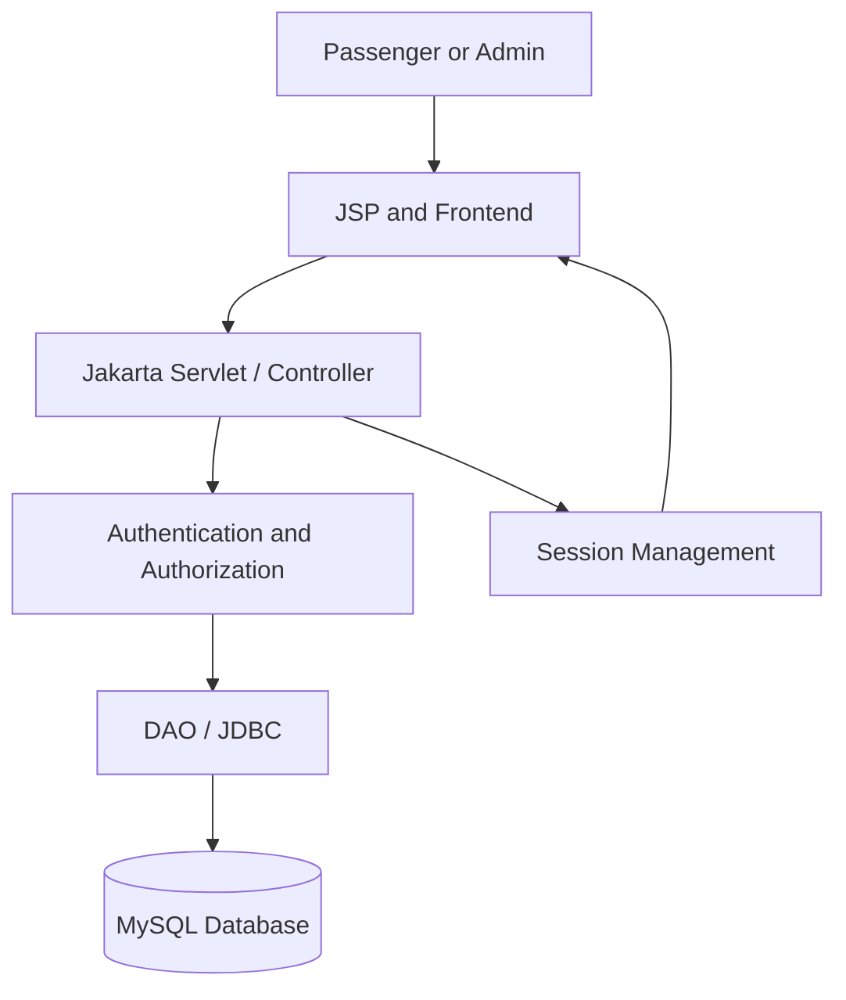
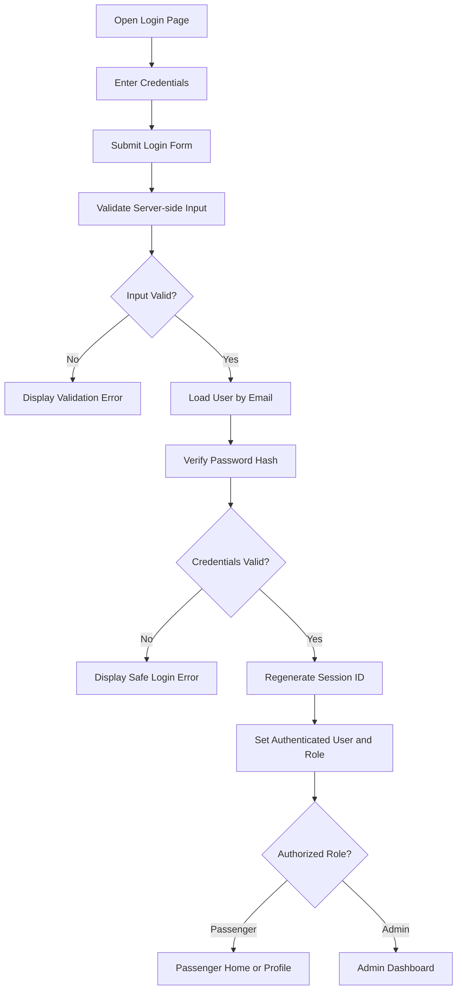
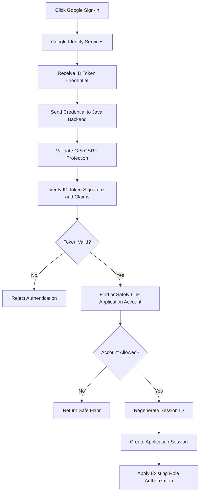
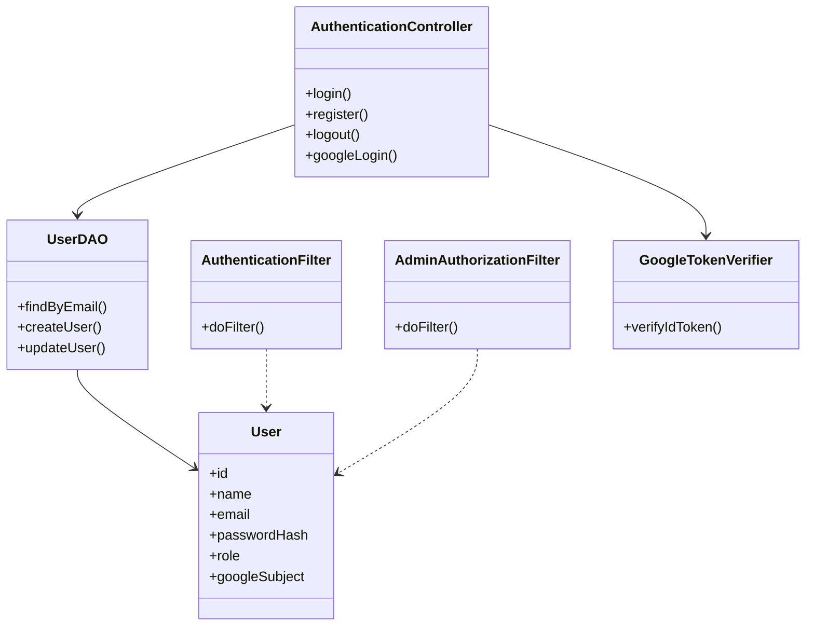

# ✈️ SkyTech - Airline Reservation & Passenger Management System

[](https://www.oracle.com/java/)
[-E03C11?logo=eclipseide&logoColor=white)](https://jakarta.ee/)
[](https://www.mysql.com/)
[](https://tomcat.apache.org/)
[](https://getbootstrap.com/)
[]()

---

# ✈️ SkyTech - Airline Reservation & Passenger Management System

[](https://www.oracle.com/java/)

[-E03C11?logo=eclipseide&logoColor=white)](https://jakarta.ee/)

[](https://www.mysql.com/)

[](https://tomcat.apache.org/)

[](https://getbootstrap.com/)

[]()

---

# SkyTech Airlines — Authentication & User Management

**Project:** SkyTech Airlines — Airline Reservation System  

**Developer:** Mohammed Sahil  

**Mentor:** Er. Ram Babu Buri  

**Department:** Department of Computer Science and Engineering (CSE)  

**Project Period:** 6 July 2026 – 6 October 2026  

**Technology Stack:** Java 21, JSP, Jakarta Servlets, JDBC, MySQL, Maven, Bootstrap 5, HTML, CSS and JavaScript

---

## 1. Project Overview

SkyTech Airlines is a Java-based Airline Reservation System developed as a college Project-Based Learning (PBL) project. The system is intended to provide an integrated platform for passenger authentication, flight discovery, reservation management, ticket handling and administrative flight management.

The application follows the existing Model–View–Controller (MVC) structure, using JSP pages for the user interface, Servlets for request processing, DAO/JDBC for database operations, and MySQL for persistent storage.

The project aims to provide a consistent, secure and user-friendly airline reservation experience through a shared aviation-inspired interface.

## 2. My Module: Authentication & User Management

My primary responsibility is the Authentication & User Management module.

### Responsibilities

- Passenger registration and account creation.

- Email/password login.

- Logout and session invalidation.

- User profile viewing and profile updates where required by the agreed scope.

- Secure password hashing and password verification.

- Server-side input validation.

- Role-based authorization for Passenger and Admin users.

- Protection of restricted pages using authentication and authorization checks.

- Google Sign-In integration using Google Identity Services.

- Integration with the existing MySQL user database and application session.

- Authentication testing, security review and technical documentation.

### Google Sign-In

Google Sign-In is an additional authentication method, not a replacement for the existing login system.

The browser obtains a Google ID token through Google Identity Services. The Java backend verifies that token before identifying or creating the corresponding application account. The application then establishes its own session and applies the existing authorization rules.

A Google-authenticated passenger must not automatically receive administrative permissions.

**Verification status:** Update this section after testing the configured Google Client ID, backend token verification, database integration and session flow.

## 3. Technology Stack

| Technology | Purpose |

|---|---|

| Java 21 | Backend programming language |

| JSP | Dynamic server-rendered pages |

| Jakarta Servlets | HTTP request handling |

| JDBC | Java-to-MySQL database connectivity |

| MySQL | Persistent application data |

| Maven | Dependency management and WAR packaging |

| Bootstrap 5 | Responsive interface components |

| HTML, CSS and JavaScript | Frontend structure, styling and interactions |

| Google Identity Services | Google authentication interface and ID token issuance |

| Tomcat 10.1+ | Compatible Jakarta Servlet web container |

The final technology list should reflect the actual dependencies and runtime used by the repository.

## 4. System Architecture

The application uses a layered MVC-style architecture.



### Layer responsibilities

- **View:** JSP pages display forms, profiles, feedback and navigation.

- **Controller:** Servlets receive HTTP requests and coordinate application operations.

- **Security:** Authentication filters, role checks and session management protect restricted resources.

- **DAO:** JDBC-based data access retrieves and updates records using parameterized queries.

- **Database:** MySQL stores account information and other application data.

The diagram is conceptual. Confirm the actual class and filter boundaries in the repository before using it as a final implementation diagram.

## 5. Authentication Flow

### Email/password login



### Google Sign-In



## 6. Core Security Requirements

- Never store passwords in plaintext.

- Use a suitable password-hashing algorithm and verify hashes correctly.

- Use parameterized SQL queries to prevent SQL injection.

- Validate user input on the server, even when browser-side validation exists.

- Verify Google ID tokens on the backend; never trust browser-supplied identity claims.

- Check the token's signature, issuer, expiration and intended audience.

- Apply the appropriate Google Identity Services CSRF protection.

- Never grant the Admin role to a newly registered Google user by default.

- Regenerate the session ID after authentication.

- Invalidate the session on logout.

- Restrict protected routes according to authentication state and role.

- Keep credentials and sensitive tokens out of source control and logs.

- Handle existing accounts and Google account linking without unsafe automatic merging.

## 7. Shared UI Design System

The SkyTech Airlines interface follows a premium aviation theme.

| Design token | Hex value | Usage |

|---|---|---|

| Midnight Navy | `#071A35` | Navigation, footer, dark sections |

| Deep Aviation Blue | `#0B2D52` | Panels and secondary surfaces |

| Sky Electric Blue | `#168BFF` | Primary buttons and links |

| Sky Cyan | `#56CCF2` | Accents and gradients |

| Cloud White | `#F4F8FC` | Page backgrounds |

| Pure White | `#FFFFFF` | Cards and form surfaces |

| Success Green | `#18A878` | Successful actions |

| Alert Red | `#E5484D` | Errors and warnings |

| Primary Text | `#172B45` | Main content |

| Muted Text | `#64748B` | Supporting content |

| Border | `#D8E3EF` | Form and card boundaries |

All modules should use the shared CSS variables and reusable components. The navbar, buttons, typography, forms, cards, validation messages, spacing and animations should remain consistent throughout the application.

## 8. Database and Configuration

The authentication module must use the existing project schema and connection configuration.

Before running the application:

1. Start the local MySQL server.

2. Create or select the database specified by the project configuration.

3. Apply the repository's existing SQL schema.

4. Apply any documented authentication migration that is actually required.

5. Configure database credentials outside committed source files.

6. Configure the Google Web Client ID for the GIS frontend.

7. Confirm that the backend uses the same intended Client ID for audience verification.

Do not recreate the database or delete existing user records merely to make authentication work.

## 9. Development Timeline

The following is a concise phase-based summary for the project period, 6 July–6 October 2026. Confirm it against your actual Git history, project logs, commits and completed work before submitting it as a factual activity report.

| Period | Work summary |

|---|---|

| 6–19 July 2026 | Project understanding, requirements analysis, initial architecture review and module planning. |

| 20 July–9 August 2026 | Authentication workflow design, database/schema review and identification of registration, login, session and role requirements. |

| 10–30 August 2026 | Authentication implementation and integration with existing JSP, Servlet, DAO and database patterns. |

| 31 August–20 September 2026 | UI refinement, shared theme alignment, validation, session/security checks and module integration. |

| 21 September–6 October 2026 | Testing, bug fixing, documentation, UML/flowchart preparation and review of outstanding tasks. |

**Reporting note:** These are suggested reporting phases, not proof that each activity was completed on those exact dates. Replace or refine them using your actual project history. Include Google Sign-In in the timeline only for the period when you genuinely implemented it.

## 10. Testing and Completion Status

Update the following table only after testing.

| Test | Status |

|---|---|

| Registration with valid data | NOT VERIFIED |

| Duplicate-email handling | NOT VERIFIED |

| Password hashing and verification | NOT VERIFIED |

| Successful and failed login | NOT VERIFIED |

| Logout and session invalidation | NOT VERIFIED |

| Unauthorized page access | NOT VERIFIED |

| Passenger/Admin authorization | NOT VERIFIED |

| Google ID token verification | NOT VERIFIED |

| Google account linking | NOT VERIFIED |

| Maven build | NOT VERIFIED |

| Database integration | NOT VERIFIED |

| Responsive UI and theme consistency | NOT VERIFIED |

Use `COMPLETE`, `PARTIAL`, `MISSING`, `BLOCKED` or `NOT VERIFIED` after collecting evidence. A successful build alone does not prove that every authentication flow is correct.

## 11. Running the Project

1. Install a compatible JDK, Maven, MySQL and Tomcat runtime.

2. Configure the local database credentials using the existing project configuration.

3. Execute the repository's SQL schema and required migrations.

4. Configure Google Identity Services if testing Google Sign-In.

5. From the project root, run:

```bash

mvn clean package

```

6. Confirm the build result and locate the generated WAR under `target/`.

7. Deploy the WAR to the configured Tomcat server.

8. Start Tomcat and review its logs.

9. Open the application using the actual context path shown by the deployment.

10. Test registration, password login, profile access, logout, protected routes and Google Sign-In.

Actual configuration paths, deployment context and commands should be verified against the repository and local environment.

## 12. UML Class Diagram

The following is a conceptual authentication model. Adjust the class and method names to match the actual implementation.



The diagram illustrates responsibilities, not a guarantee that every class already exists. Do not add a `GoogleTokenVerifier` class solely to match the diagram if the project uses a different verified implementation structure.

## 13. Known Limitations and Future Scope

Document only limitations that are actually present.

Potential future improvements include:

- Email ownership verification where separately required.

- Account recovery and password-reset workflow.

- Additional authentication protections and audit logging.

- More comprehensive automated integration tests.

- Better accessibility and responsive design.

- Improved deployment configuration and monitoring.

- Integration with live flight status or map services, subject to data-provider terms and availability.

## 14. References

- Google Identity Services — Client ID setup: https://developers.google.com/identity/gsi/web/guides/get-google-api-clientid

- Google Identity Services — ID token verification: https://developers.google.com/identity/gsi/web/guides/verify-google-id-token

- OpenID Connect: https://developers.google.com/identity/openid-connect/openid-connect

---

## 🛠️ Technology Stack & Justification

| Technology | Role | Why This Technology Was Chosen |

| :--- | :--- | :--- |

| **Java 21 (LTS)** | Backend Core Language | Long-Term Support release offering record-breaking JVM performance, modern pattern matching, strong memory safety, and virtual-thread scalability. |

| **Jakarta Servlet 6.0** | HTTP Web Request Handling | Standard enterprise Java web specification with the modern `jakarta.*` namespace. Provides non-blocking I/O support, robust session lifecycle management, and filter chains. |

| **Jakarta JSP 3.1 & JSTL 3.0** | Server-Side Presentation | Clean separation of business logic from presentation. Tag libraries eliminate scriptlets, preventing XSS and enforcing clean MVC architecture. |

| **MySQL 8.3 & Connector/J** | Relational Database & Driver | High-performance ACID-compliant relational persistence, indexed email lookups, and support for concurrent passenger booking transactions. |

| **Apache Tomcat 10.1.x** | Application Server Container | Native support for Jakarta EE 10 deployment descriptors (`web.xml` v6.0) and Servlet 6.0 specifications. |

| **Vanilla CSS + Bootstrap 5.3** | UI & Glassmorphism Design | Zero heavy JavaScript framework dependencies. Lightning-fast page load times, full responsiveness, Google Fonts (*Plus Jakarta Sans*), and smooth micro-animations. |

| **SHA-256 + Cryptographic Salt** | Security & Password Hashing | Every password is salted with a unique random hex string and hashed using SHA-256, completely mitigating rainbow table and precomputation attacks. |

| **Role-Based Access Control (RBAC)** | Authorization | Dedicated `AuthenticationFilter` and `AdminAuthorizationFilter` guard protected endpoints (`/profile`, `/admin/*`) at the servlet container level. |

---

## 📂 Project Architecture & Directory Structure

```plaintext

Airline-Reservation-System/

├── pom.xml                                # Maven build descriptor (Java 21, Jakarta EE 10, MySQL)

├── .gitignore                             # Clean VCS ignore rules (excludes target/, IDE files)

├── Readme.md                              # Comprehensive system documentation & roadmap

├── sql/

│   └── schema.sql                         # Database schema & pre-seeded test accounts

└── src/

    ├── main/

    │   ├── java/com/airline/

    │   │   ├── controller/                # Servlet HTTP Controllers (@WebServlet)

    │   │   │   ├── AdminDashboardServlet.java

    │   │   │   ├── LoginServlet.java

    │   │   │   ├── LogoutServlet.java

    │   │   │   ├── ProfileServlet.java

    │   │   │   └── RegisterServlet.java

    │   │   ├── dao/                       # Data Access Layer (JDBC queries)

    │   │   │   ├── UserDao.java

    │   │   │   └── UserDaoImpl.java

    │   │   ├── filter/                    # Security & Authorization Filters (@WebFilter)

    │   │   │   ├── AdminAuthorizationFilter.java

    │   │   │   └── AuthenticationFilter.java

    │   │   ├── model/                     # Domain Entities

    │   │   │   ├── Role.java

    │   │   │   └── User.java

    │   │   ├── service/                   # Business Logic & Validation

    │   │   │   ├── ServiceResult.java

    │   │   │   └── UserService.java

    │   │   └── util/                      # Utilities & Singleton Connection

    │   │       ├── DBConnection.java

    │   │       ├── PasswordUtil.java

    │   │       └── ValidationUtil.java

    │   ├── resources/

    │   │   └── db.properties              # MySQL JDBC connection parameters

    │   └── webapp/

    │       ├── index.jsp                  # SkyTech landing page (Hero, Flights, Seat Selector, Boarding Pass)

    │       ├── css/

    │       │   └── custom.css             # SkyTech glassmorphic stylesheet & design tokens

    │       ├── js/

    │       │   └── auth-validation.js     # Client-side form & password strength validation

    │       ├── images/                    # Aviation & service photography assets

    │       │   ├── plane-hero.jpg

    │       │   ├── service-lounge.jpg

    │       │   ├── service-car.jpg

    │       │   ├── service-hotel.jpg

    │       │   └── service-vip.jpg

    │       └── WEB-INF/

    │           ├── web.xml                # Jakarta EE 10 deployment descriptor

    │           └── views/

    │               ├── admin/dashboard.jsp

    │               ├── auth/login.jsp

    │               ├── auth/register.jsp

    │               ├── common/header.jsp

    │               ├── common/navbar.jsp

    │               ├── common/footer.jsp

    │               ├── errors/403.jsp

    │               ├── errors/404.jsp

    │               └── profile/profile.jsp

    └── test/java/com/airline/util/        # JUnit 5 & Mockito test suites

        ├── PasswordUtilTest.java

        └── ValidationUtilTest.java

```

## 🚀 Step-by-Step Local Execution Guide (Windows PowerShell)

### Step 1: Initialize Database & Verify Connectivity

Verify MySQL is active on port 3306:

```powershell

Test-NetConnection -ComputerName localhost -Port 3306

```

Apply the schema and seed accounts:

```powershell

Get-Content .\sql\schema.sql | mysql -u root -p

```

Verify seeded records:

```powershell

mysql -u root -p -e "USE airline_db; SELECT user_id, email, first_name, last_name, role, status FROM users;"

```

### Step 2: Build the WAR Package with Maven

```powershell

mvn clean package

```

*Creates `target\airline-reservation-system.war` using Java 21.*

### Step 3: Deploy to Apache Tomcat 10.1

Set your Tomcat home environment variable:

```powershell

Env: Catalina Home = "C:\apache-tomcat-10.1.x"   # Adjust to your local Tomcat path

```

Deploy the WAR package to Tomcat's `webapps` folder:

```powershell

Copy-Item .\target\airline-reservation-system.war -Destination "Env: Catalina Home\webapps\" -Force

```

Start Tomcat:

```powershell

& "Env: Catalina Home\bin\startup.bat"

```

*(To stop Tomcat when finished: `& "Env: Catalina Home\bin\shutdown.bat"`)*

### Step 4: Access in the Browser

```powershell

# SkyTech Homepage (Flight Search, Seat Map, Boarding Pass, Services)

Start-Process "http://localhost:8080/airline-reservation-system/"

# Passenger & Admin Sign In

Start-Process "http://localhost:8080/airline-reservation-system/login"

# Passenger Account Registration

Start-Process "http://localhost:8080/airline-reservation-system/register"

```

---

## 📋 Detailed Project Task Breakdown & Roadmap

### ✅ Completed Milestones (Phase 1)

- [x] **Project Foundation:** Jakarta EE 10 + Java 21 build configuration in Maven.

- [x] **Database Architecture:** MySQL 8 `airline_db` schema, salted hashing, connection pool singleton.

- [x] **Authentication Engine:**

  - [x] Registration controller with regex validation for names, phone, email, password strength.

  - [x] Login controller with session establishment and role-based routing.

  - [x] Logout servlet with session invalidation.

- [x] **Security Filters:**

  - [x] `AuthenticationFilter` guarding passenger profiles and administrative endpoints.

  - [x] `AdminAuthorizationFilter` restricting `/admin/*` solely to `ADMIN` role.

- [x] **Profile & Admin Modules:**

  - [x] Personal details editing and secure password changing.

  - [x] Administrator Dashboard with KPI cards and account suspension/activation controls.

- [x] **SkyTech Visual Overhaul:**

  - [x] Bespoke aviation design system (Plus Jakarta Sans, Sky Blue palette, glassmorphic cards).

  - [x] High-resolution airliner flying in sky hero banner.

  - [x] Flight search bar with date pickers and live pricing filters.

  - [x] Interactive cabin seat selection map with real-time fare tally.

  - [x] Digital boarding pass with QR code and flight notifications.

  - [x] Airport hospitality services gallery (Lounges, Car Rentals, Hotels, VIP).

  - [x] Custom error handling (404 Not Found & 403 Forbidden views).

### ⏳ Upcoming Milestones (Roadmap)

- [ ] **Phase 2: Dynamic Flight Schedule Engine:**

  - [ ] Add `flights`, `airports`, and `routes` tables in MySQL.

  - [ ] Implement search servlet querying flights by origin, destination, date, and available seats.

- [ ] **Phase 3: Real-Time Seat Reservation & Booking Transactions:**

  - [ ] Add `bookings`, `tickets`, and `passengers` tables.

  - [ ] Implement atomic JDBC transaction locking selected seats during checkout.

- [ ] **Phase 4: Payment Gateway & Boarding Pass PDF Generation:**

  - [ ] Integrate Stripe / PayPal mock payment gateway.

  - [ ] Generate downloadable PDF boarding pass with iText / PDFBox.

- [ ] **Phase 5: Automated Email & Flight Status Notifications:**

  - [ ] Send booking confirmation and flight delay emails via Jakarta Mail.

---

**Prepared by:** Mohammed Sahil  

**Mentor:** Er. Ram Babu Buri  

**Department:** Computer Science and Engineering (CSE)  

**Project:** SkyTech Airlines — Airline Reservation System

⋮⋮⋮⋮⋮⋮⋮⋮